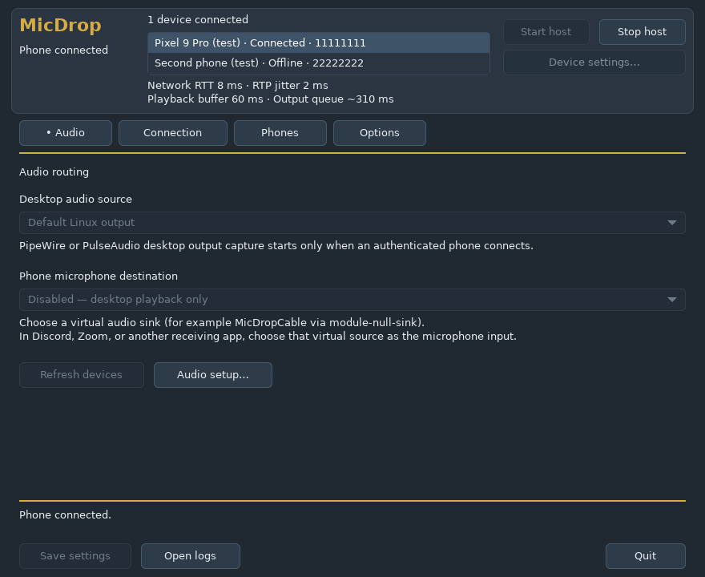
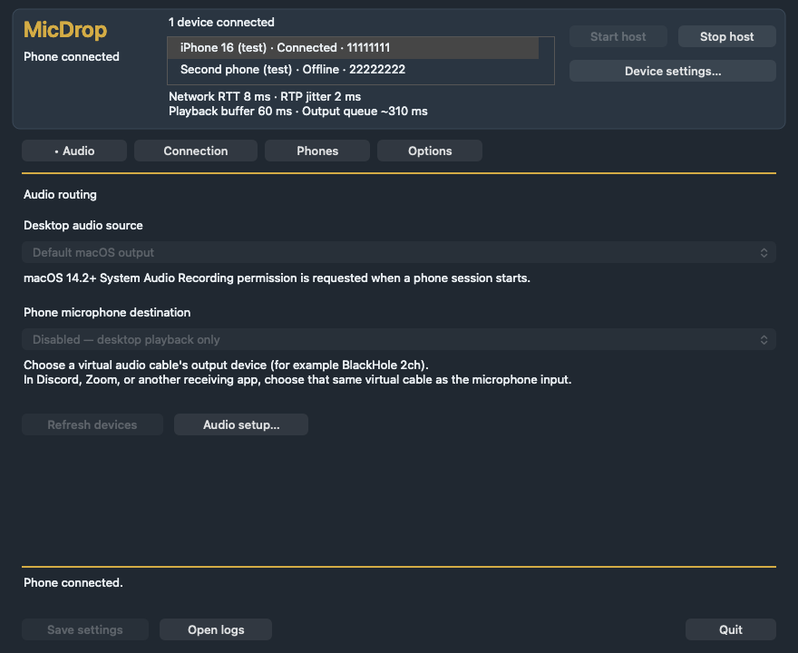
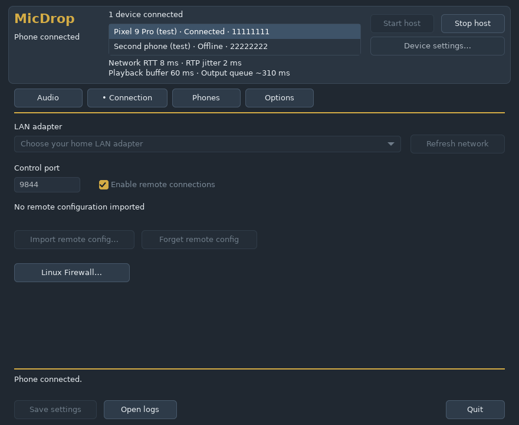
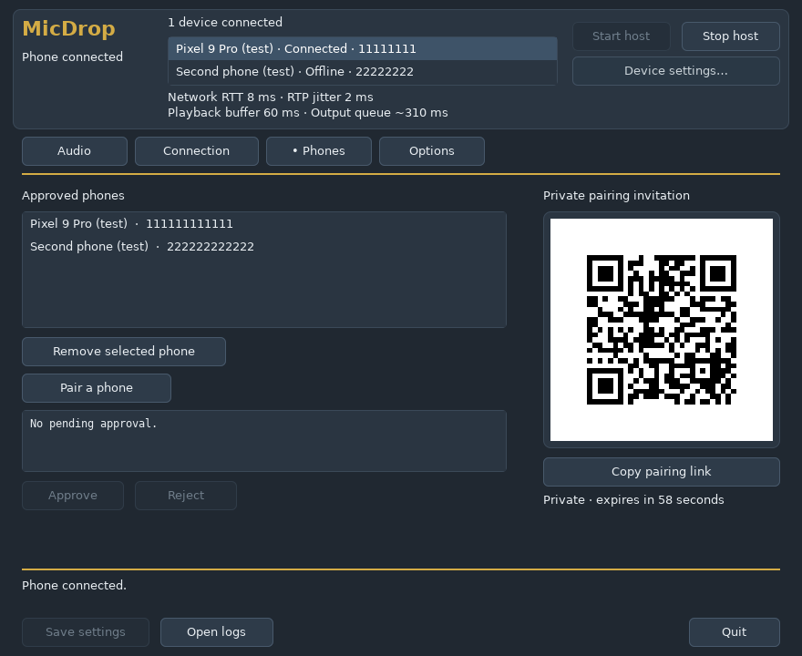
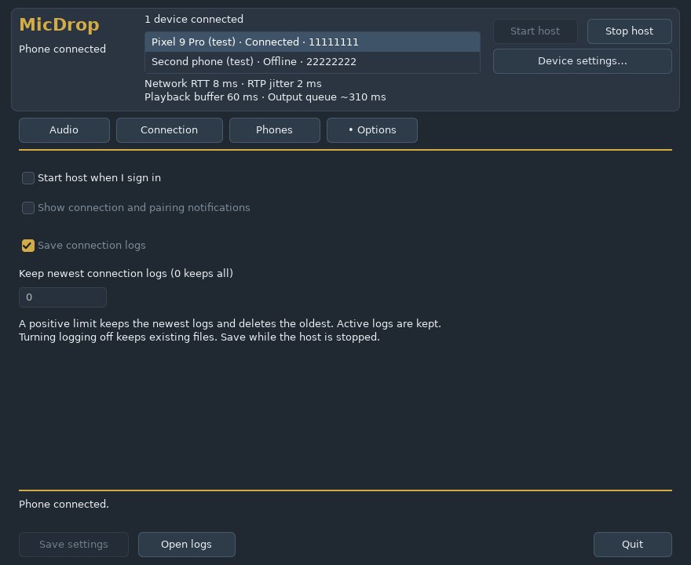
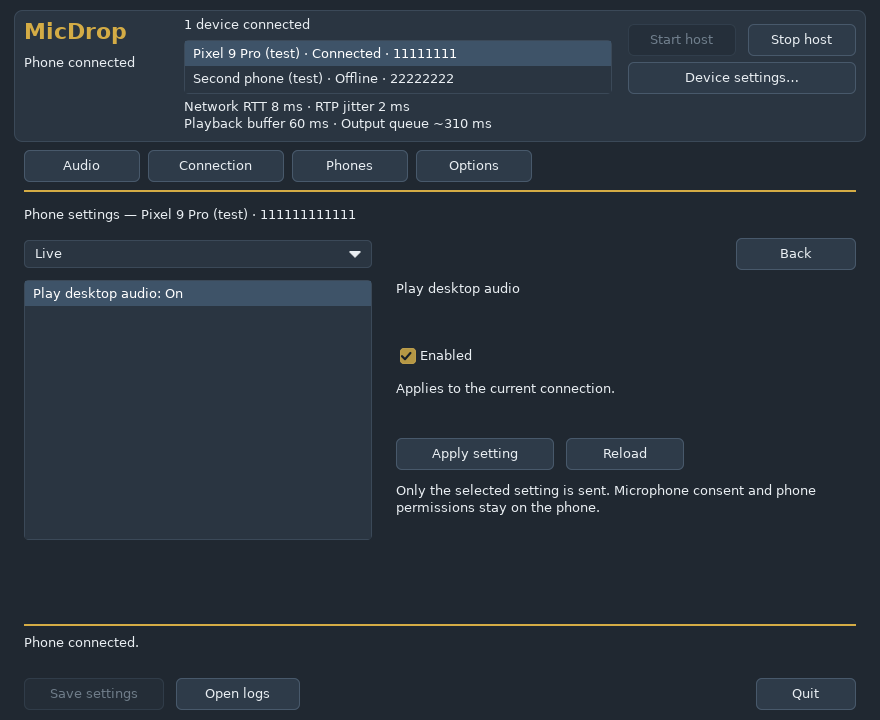
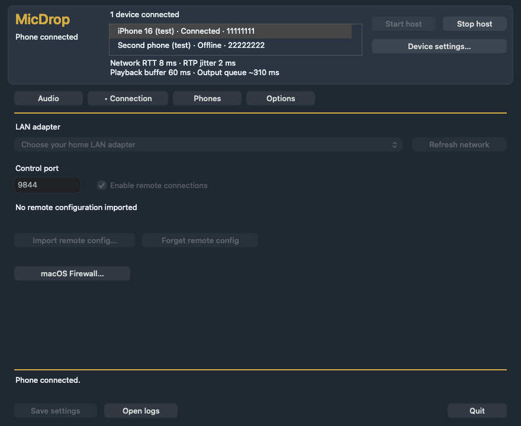
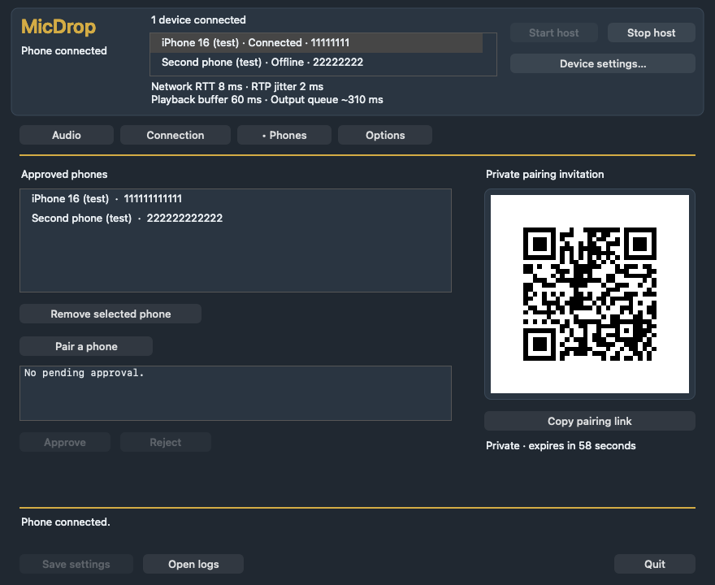
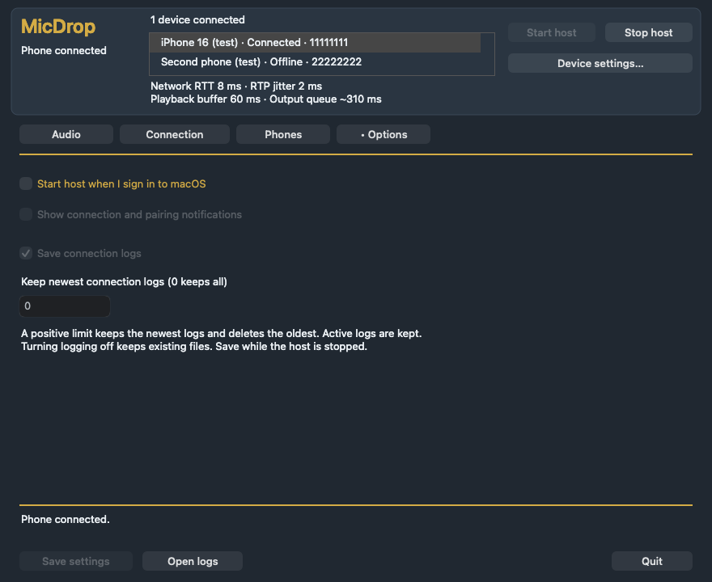
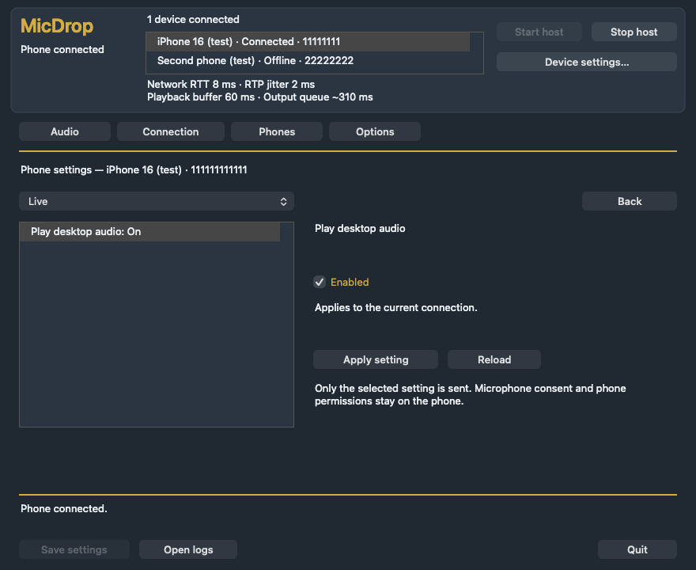

# MicDrop

Use your Android phone or iPhone—and its connected headphones or headset—as a
wireless speaker, microphone, or two-way headset for your Windows 11 PC, with
experimental Linux x64 and Apple Silicon macOS 14.2+ desktop and CLI host support.

**[Official Website](https://maskarauder.com/micdrop/)** · **[Latest Releases](https://github.com/maskarauder/MicDrop/releases)** · **[Setup & Audio Guides](https://maskarauder.com/guides/)** · **[Audio Tools](https://maskarauder.com/tools/)** · **[Privacy Policy](https://maskarauder.com/micdrop/privacy/)**

**Status: public beta.** Windows and Android LAN/remote streaming have passed
functional acceptance on tested hardware; the iPhone app has passed Apple CI and
initial LAN duplex/mute checks, with broader physical route, locked-screen, and
remote device testing still underway. The Linux x64 host (`micdrop-host` CLI and
GTK3 `micdrop-host desktop` GUI) is verified against live PulseAudio/PipeWire
loopback and Xvfb GTK3 UI contracts in CI, and the Apple Silicon macOS 14.2+ host
(`MicDrop.app` and `micdrop-host`) is verified in `macos-26` CI (AppKit UI,
bundle/signing, and WebRTC loopback) — **community feedback from physical Apple
Silicon Mac hardware is actively requested** (see
[macOS desktop](docs/MACOS_DESKTOP.md#hardware-testing-status--feedback-wanted)).

## Features

- **Listen, talk, or both:** Stream desktop audio to your phone, send your phone
  or headset microphone back to desktop apps, or run full duplex over WebRTC/Opus.
- **No account or cloud required:** Works directly over your local Wi-Fi/LAN
  with automatic host discovery and no internet dependency.
- **Private pairing:** Scan a QR code or paste an invitation link on your phone
  and approve the device on your desktop host. Revoke paired phones anytime.
- **Built for daily use:** Choose audio outputs and inputs from the phone, mute,
  pause/resume, keep streaming with the screen off, and recover automatically
  from brief Wi-Fi or headset interruptions.
- **Optional remote access:** Connect away from home through a self-hosted
  rendezvous and TURN relay service when you need it.

## Download & Quick Start

Download matching desktop and phone packages from the latest release on the
**[Releases page](https://github.com/maskarauder/MicDrop/releases)**:

| Platform | Download | Notes |
| --- | --- | --- |
| **Windows 11 (x64)** | `MicDrop-*-windows-x64-setup.exe` or `MicDrop-*-windows-x64-portable.zip` | Per-user installer ([guide](docs/WINDOWS_INSTALLER.md)) or portable ZIP (Authenticode-signed when release signing is configured; see release notes) |
| **Android 12+ (arm64)** | `MicDrop-*-android-arm64-dev.apk` | Sideload APK ([guide](docs/ANDROID.md)); same-key updates keep your pairing |
| **iPhone (iOS 17+ arm64)** | TestFlight invite or `MicDrop-*-ios-arm64-unsigned.ipa` | Install via Apple TestFlight or sideload with your Apple ID via Sideloadly / iloader ([guide](docs/DEVELOPMENT.md#install-on-iphone)) |
| **macOS 14.2+ (Apple Silicon arm64)** | `MicDrop-*-macos-arm64-app.zip` or `MicDrop-*-macos-arm64-host.tar.gz` | Experimental AppKit `MicDrop.app` & CLI host ([guide](docs/MACOS_DESKTOP.md); Developer ID signed & Apple-notarized when configured); Apple Silicon hardware feedback welcome |
| **Linux (x64)** | `MicDrop-*-linux-x64-host.tar.gz` | GTK3 desktop GUI & PipeWire/PulseAudio CLI host ([desktop guide](docs/LINUX_DESKTOP.md), [audio guide](docs/PLATFORM_AUDIO.md#linux-host)) and optional rendezvous service ([guide](docs/SERVICE_DEPLOYMENT.md)) |

### Setup in 4 Steps

1. **Install or launch on your computer:**
   - **Windows 11:** Run the setup installer (or extract the portable ZIP) and
     launch **MicDrop** from the Start menu or system tray
     ([Windows guide](docs/WINDOWS_DESKTOP.md)).
   - **macOS 14.2+ (Apple Silicon):** Open **MicDrop.app** (or run
     `./micdrop-host desktop` from the CLI; [macOS guide](docs/MACOS_DESKTOP.md)).
   - **Linux (x64):** Run `./micdrop-host desktop` (or
     `./micdrop-host desktop --install-launcher` to add an application menu
     entry; [Linux guide](docs/LINUX_DESKTOP.md)).
2. **Install on your phone:** Install the matching Android `.apk`
   ([Android streaming guide](https://maskarauder.com/guides/stream-pc-audio-to-android/)),
   install via **TestFlight** on iPhone, or sideload the iPhone `.ipa` from the
   same release version
   ([iPhone streaming guide](https://maskarauder.com/guides/stream-pc-audio-to-iphone/)).
3. **Pair your phone:** Open the **Phones** tab and click **Pair a phone** in
   the desktop app, scan the QR code (or paste the link) on your phone, verify
   the request ID, and click **Approve** on your computer.
4. **Connect:** Tap **Connect** on your phone to start listening to desktop
   audio.
   - **Using your phone as a desktop microphone?** Follow
     [how to use your phone as a Windows microphone](https://maskarauder.com/guides/use-phone-as-windows-microphone/)
     and set up a [virtual audio cable or sink](docs/VIRTUAL_AUDIO_CABLE.md)
     (see [VB-CABLE setup](https://maskarauder.com/guides/vb-cable-setup-windows/),
     [Discord setup](https://maskarauder.com/guides/phone-microphone-discord/), and
     [OBS setup](https://maskarauder.com/guides/phone-microphone-obs/)).
   - **Connecting outside your home Wi-Fi?** See the optional
     [remote access guide](docs/REMOTE_ACCESS.md).

## Setup Guides, Troubleshooting & Audio Tools

Step-by-step walkthroughs, routing checklists, and browser sound checks on
**[maskarauder.com](https://maskarauder.com/guides/)**:

| Topic | Guide |
| --- | --- |
| **Listen on phone** | [Stream PC audio to an Android phone](https://maskarauder.com/guides/stream-pc-audio-to-android/) · [Stream Windows PC audio to an iPhone](https://maskarauder.com/guides/stream-pc-audio-to-iphone/) · [Stream Mac audio to phone](https://maskarauder.com/guides/stream-mac-audio-to-phone/) · [Stream Linux audio to phone](https://maskarauder.com/guides/stream-linux-audio-to-phone/) |
| **Phone as PC mic** | [Use your phone as a Windows microphone](https://maskarauder.com/guides/use-phone-as-windows-microphone/) · [VB-CABLE Input vs. Output setup](https://maskarauder.com/guides/vb-cable-setup-windows/) |
| **Voice & streaming apps** | [Phone microphone in Discord](https://maskarauder.com/guides/phone-microphone-discord/) · [Phone microphone in OBS](https://maskarauder.com/guides/phone-microphone-obs/) |
| **Connection & playback fixes** | [Connected but no sound](https://maskarauder.com/guides/micdrop-no-sound/) · [Cannot find or connect on LAN](https://maskarauder.com/guides/micdrop-connection-troubleshooting/) · [Android audio stops with screen off](https://maskarauder.com/guides/android-audio-stops-screen-off/) |
| **Latency & Bluetooth** | [Reduce PC-to-phone audio delay](https://maskarauder.com/guides/reduce-pc-to-phone-audio-latency/) · [Measure audio latency honestly](https://maskarauder.com/guides/measure-audio-latency/) · [Why Bluetooth sounds worse when the mic turns on](https://maskarauder.com/guides/bluetooth-headphones-bad-sound-microphone/) |
| **Browser audio tools** | [Microphone Test](https://maskarauder.com/tools/microphone-test/) · [Left / Right Stereo Test](https://maskarauder.com/tools/stereo-test/) · [Tone & Noise Generator](https://maskarauder.com/tools/tone-generator/) · [Discord & OBS Routing Helper](https://maskarauder.com/tools/audio-routing/) · [WAV File Inspector](https://maskarauder.com/tools/wav-inspector/) · [Audio Sync Check](https://maskarauder.com/tools/audio-sync-test/) |

<strong>General Windows 11 &amp; Mac audio troubleshooting guides on maskarauder.com</strong>

- [No sound on Windows 11: step-by-step fix](https://maskarauder.com/guides/windows-11-no-sound/)
- [Microphone not working on Windows 11](https://maskarauder.com/guides/windows-microphone-not-working/)
- [Crackling or popping audio on Windows 11](https://maskarauder.com/guides/windows-audio-crackling-popping/)
- [Windows volume too low even at 100%](https://maskarauder.com/guides/windows-volume-too-low/)
- [Bluetooth headphones connected but no sound on Windows 11](https://maskarauder.com/guides/bluetooth-connected-no-sound/)
- [Why can I hear myself in my headset? Fix microphone echo](https://maskarauder.com/guides/microphone-echo-hear-yourself/)
- [USB headset or microphone not detected on Windows 11](https://maskarauder.com/guides/usb-headset-not-detected/)
- [HDMI monitor or TV has no sound on Windows](https://maskarauder.com/guides/hdmi-monitor-no-sound/)
- [No sound in Chrome, a game, or one app](https://maskarauder.com/guides/browser-or-app-no-sound/)
- [No sound on a Mac](https://maskarauder.com/guides/mac-no-sound/)

## Desktop UI Preview

Native dark slate & gold desktop UIs sharing the same host engine across
Windows (`MicDrop.exe`), Linux GTK3 (`micdrop-host desktop`), and Apple Silicon
macOS AppKit (`MicDrop.app`):

| Linux GTK3 (`micdrop-host desktop`) | macOS AppKit (`MicDrop.app`) |
| --- | --- |
|  |  |

<strong>More Linux desktop screenshots (Connection, Phones &amp; QR, Options, Phone Settings)</strong>

| Connection | Phones & QR Pairing |
| --- | --- |
|  |  |

| Options | Connected Phone Settings Editor |
| --- | --- |
|  |  |

<strong>More macOS desktop screenshots (Connection, Phones &amp; QR, Options, Phone Settings)</strong>

| Connection | Phones & QR Pairing |
| --- | --- |
|  |  |

| Options | Connected Phone Settings Editor |
| --- | --- |
|  |  |

## Things to Know

- **Package signing & platform prompts:** When cloud signing credentials are
  configured on official `main` builds, Windows x64 packages are
  **Authenticode-signed and timestamped** (newly issued certificates may still
  show a Windows SmartScreen download-reputation prompt on first run—*More info
  → Run anyway*—until download reputation builds) and Apple Silicon macOS
  packages (`MicDrop.app` and `micdrop-host`) are **Developer ID signed and
  Apple-notarized**; builds without those credentials remain unsigned on Windows
  and ad-hoc signed on macOS, while Linux x64 archives are unsigned. Check each
  release's **Package signing** note and `MicDrop-*-build.json` manifests for
  exact verified signing status. On mobile, the Android APK is sideloaded rather
  than from Google Play, and the iPhone app is available via **TestFlight** or
  by sideloading the unsigned IPA (signing with a free Apple ID requires
  refreshing every 7 days).
- **Bluetooth audio behavior:** Bluetooth headphones add device buffering delay,
  and using a classic Bluetooth headset's microphone can switch headphone
  playback to voice call quality depending on the headset and OS
  ([why Bluetooth audio changes when the mic turns on](https://maskarauder.com/guides/bluetooth-headphones-bad-sound-microphone/)).
- **Virtual cable not bundled:** Microphone return requires a separately
  configured virtual audio cable or sink (such as
  [VB-CABLE on Windows](https://maskarauder.com/guides/vb-cable-setup-windows/),
  a user-space HAL plugin like BlackHole 2ch on macOS, or a PipeWire/PulseAudio
  `module-null-sink` + `module-remap-source` pair on Linux); MicDrop does not
  install kernel audio drivers.
- **One active stream at a time:** The desktop host runs while you are signed in
  and awake, and accepts one active phone audio session at a time.
- **Latency stats vs. physical delay:** In-app RTT and buffer counters show
  network/pipeline health, not acoustic speaker-to-ear latency (see
  [reducing PC-to-phone audio delay](https://maskarauder.com/guides/reduce-pc-to-phone-audio-latency/),
  [measuring audio latency honestly](https://maskarauder.com/guides/measure-audio-latency/),
  [docs/LATENCY.md](docs/LATENCY.md), and the [roadmap](docs/ROADMAP.md)).

For step-by-step testing tips, battery/background settings (including
[Android screen-off audio](https://maskarauder.com/guides/android-audio-stops-screen-off/)),
and full user guides, see the [MicDrop website](https://maskarauder.com/micdrop/),
the [beta testing guide](docs/BETA_TESTING.md), and the
[documentation index](docs/README.md).

## Support MicDrop

MicDrop is built by **[Maskarauder](https://maskarauder.com/)**. If you find it
useful and want to support ongoing development, code-signing certificates, and
store releases, you can chip in on Ko-fi:

- **[Support MicDrop on Ko-fi (ko-fi.com/maskarauder)](https://ko-fi.com/maskarauder)**
- **[Explore all audio guides & tools on maskarauder.com](https://maskarauder.com/guides/)**

## Report Issues & Contribute

- **Bug reports:** Check [connected but no sound](https://maskarauder.com/guides/micdrop-no-sound/)
  and the [LAN connection checklist](https://maskarauder.com/guides/micdrop-connection-troubleshooting/)
  first, then open an [Issue](https://github.com/maskarauder/MicDrop/issues)
  with your app version, desktop and phone OS versions, audio route (speaker,
  wired, or Bluetooth model), and steps to reproduce. Review diagnostic reports
  before sharing and never post pairing links, relay credentials, or private
  audio.
- **Security & privacy:** Read the [MicDrop privacy policy](https://maskarauder.com/micdrop/privacy/)
  and [security guide](docs/SECURITY.md), and report vulnerabilities privately
  via [SECURITY.md](SECURITY.md) rather than a public issue.
- **Building from source & contributing:** Developers looking to build locally,
  run contract checks, or submit pull requests should start with
  [CONTRIBUTING.md](CONTRIBUTING.md) and [docs/DEVELOPMENT.md](docs/DEVELOPMENT.md).

## License

First-party MicDrop code and documentation are licensed under the
[Mozilla Public License 2.0](LICENSE). [NOTICE](NOTICE) describes repository
coverage, and third-party components retain their own licenses and notices. See
[licensing and funding](docs/LICENSING.md) for details.
