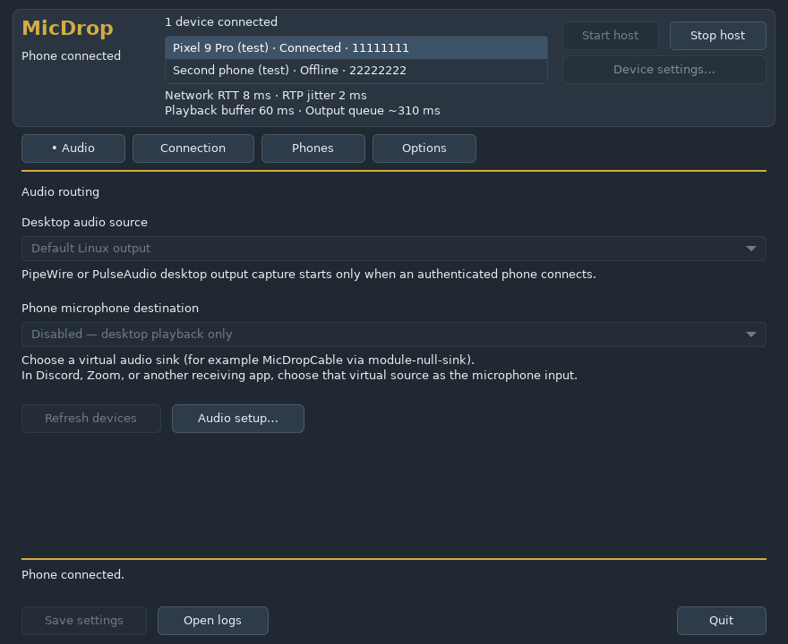
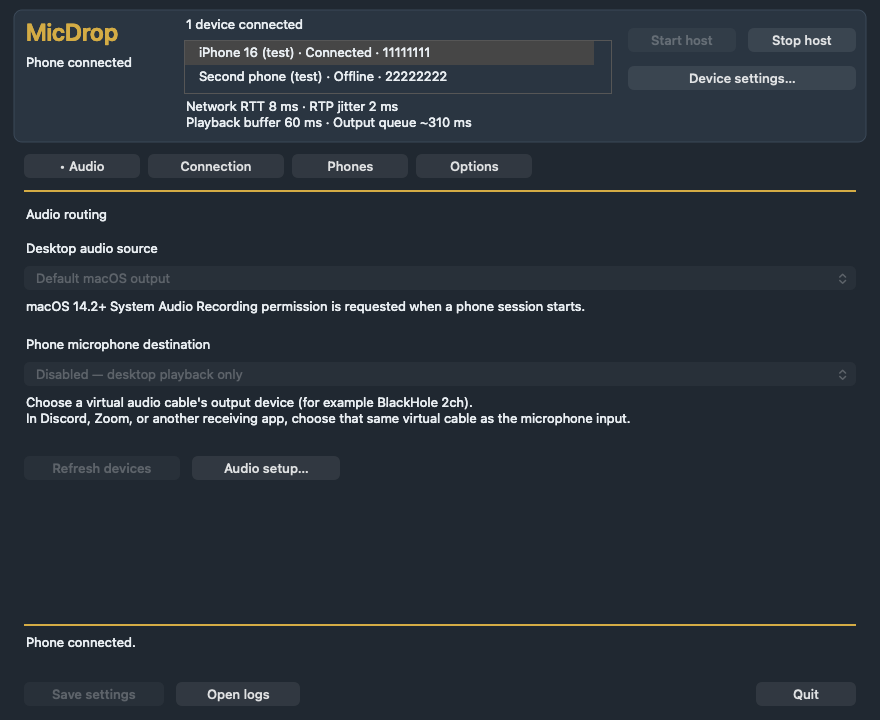
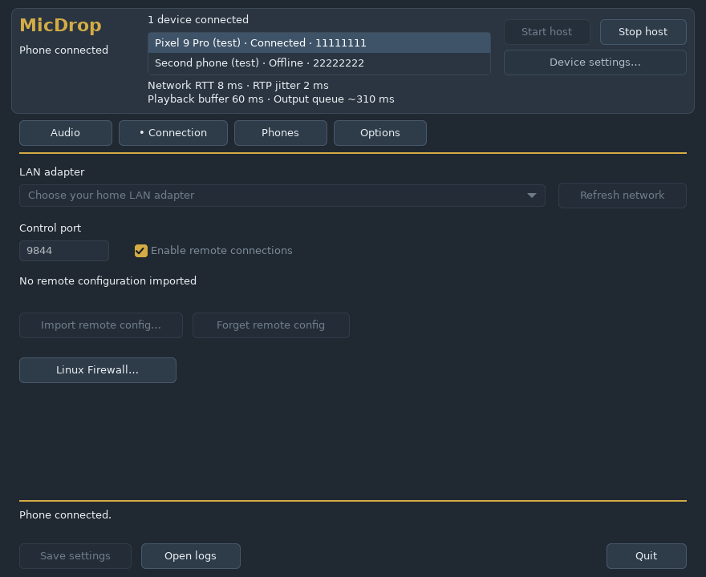
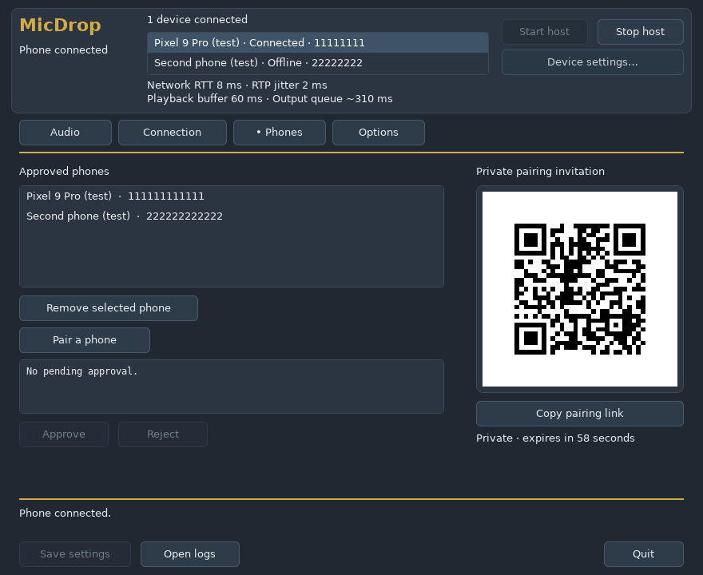
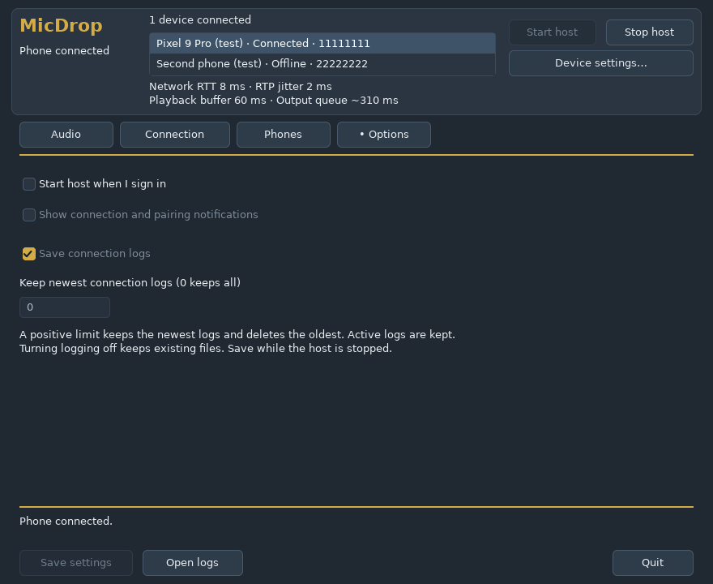
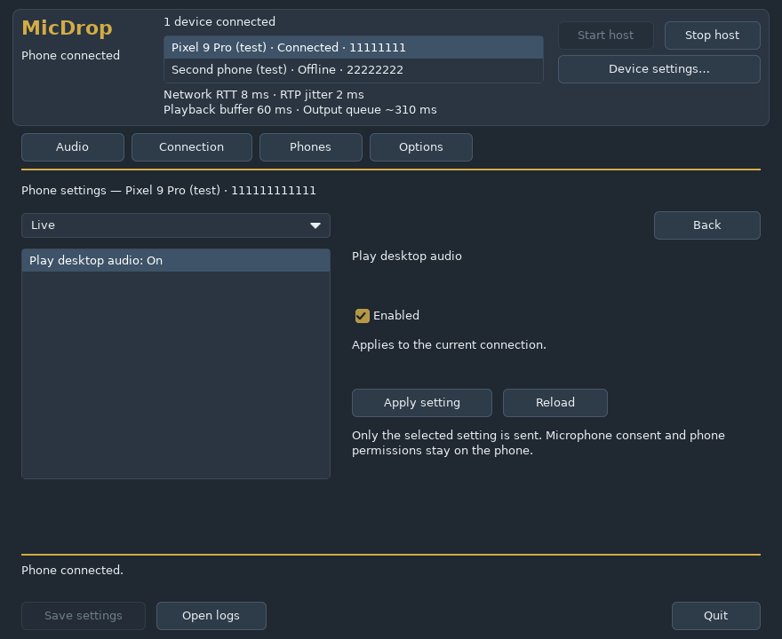
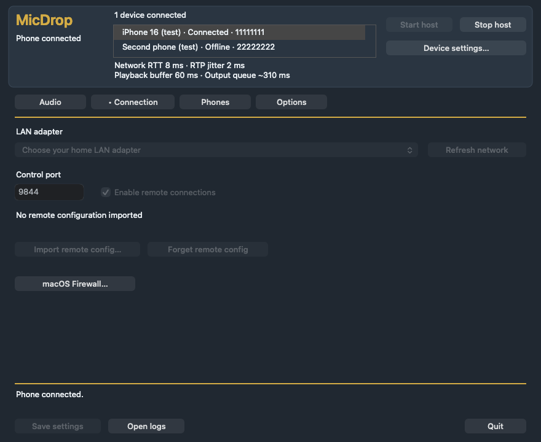
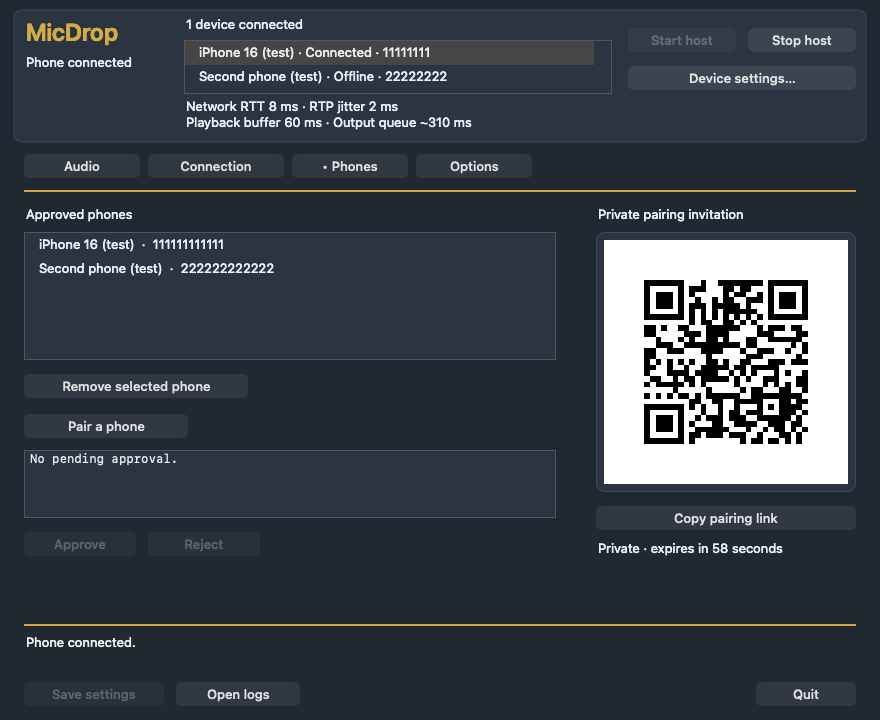
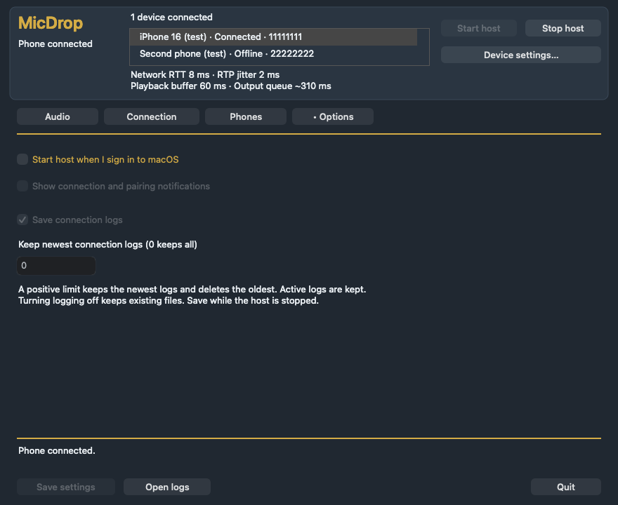
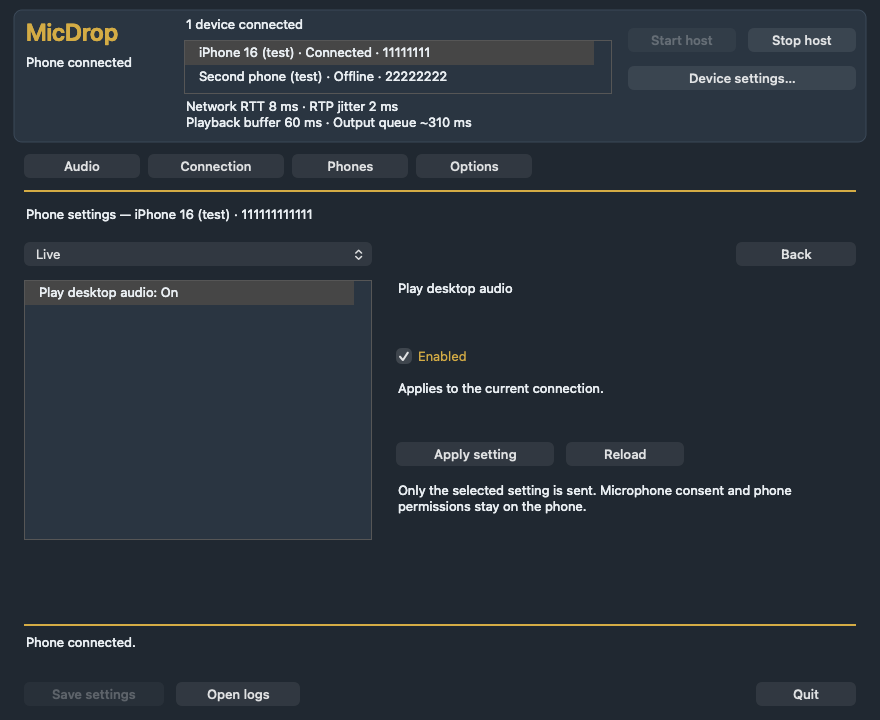

# MicDrop

Use your Android phone or iPhone—and its connected headphones or headset—as a
wireless speaker, microphone, or two-way headset for your Windows 11 PC, with
experimental Linux x64 and Apple Silicon macOS 14.2+ desktop and CLI host support.

**Status: public beta.** Windows and Android LAN/remote streaming have passed
functional acceptance on tested hardware; the iPhone app has passed Apple CI and
initial LAN duplex/mute checks, with broader physical route, locked-screen, and
remote device testing still underway. The Linux x64 host (`micdrop-host` CLI and
GTK3 `micdrop-host desktop` GUI) is verified against live PulseAudio/PipeWire
loopback and Xvfb GTK3 UI contracts in CI, and the Apple Silicon macOS 14.2+ host
(`MicDrop.app` and `micdrop-host`) is verified in `macos-26` CI (AppKit UI,
bundle/signing, and WebRTC loopback) — **community feedback from physical Apple
Silicon Mac hardware is actively requested** (see
[macOS desktop](docs/MACOS_DESKTOP.md#hardware-testing-status--feedback-wanted)).

## Features

- **Listen, talk, or both:** Stream desktop audio to your phone, send your phone
  or headset microphone back to desktop apps, or run full duplex over WebRTC/Opus.
- **No account or cloud required:** Works directly over your local Wi-Fi/LAN
  with automatic host discovery and no internet dependency.
- **Private pairing:** Scan a QR code or paste an invitation link on your phone
  and approve the device on your desktop host. Revoke paired phones anytime.
- **Built for daily use:** Choose audio outputs and inputs from the phone, mute,
  pause/resume, keep streaming with the screen off, and recover automatically
  from brief Wi-Fi or headset interruptions.
- **Optional remote access:** Connect away from home through a self-hosted
  rendezvous and TURN relay service when you need it.

## Download & Quick Start

Download matching desktop and phone packages from the latest release on the
**[Releases page](https://github.com/maskarauder/MicDrop/releases)**:

| Platform | Download | Notes |
| --- | --- | --- |
| **Windows 11 (x64)** | `MicDrop-*-windows-x64-setup.exe` or `MicDrop-*-windows-x64-portable.zip` | Authenticode-signed per-user installer ([guide](docs/WINDOWS_INSTALLER.md)) or portable ZIP |
| **Android 12+ (arm64)** | `MicDrop-*-android-arm64-dev.apk` | Sideload APK ([guide](docs/ANDROID.md)); same-key updates keep your pairing |
| **iPhone (iOS 17+ arm64)** | TestFlight invite or `MicDrop-*-ios-arm64-unsigned.ipa` | Install via Apple TestFlight or sideload with your Apple ID via Sideloadly / iloader ([guide](docs/DEVELOPMENT.md#install-on-iphone)) |
| **macOS 14.2+ (Apple Silicon arm64)** | `MicDrop-*-macos-arm64-app.zip` or `MicDrop-*-macos-arm64-host.tar.gz` | Developer ID signed & Apple-notarized experimental AppKit `MicDrop.app` & CLI host ([guide](docs/MACOS_DESKTOP.md)); Apple Silicon hardware feedback welcome |
| **Linux (x64)** | `MicDrop-*-linux-x64-host.tar.gz` | GTK3 desktop GUI & PipeWire/PulseAudio CLI host ([desktop guide](docs/LINUX_DESKTOP.md), [audio guide](docs/PLATFORM_AUDIO.md#linux-host)) and optional rendezvous service ([guide](docs/SERVICE_DEPLOYMENT.md)) |

### Setup in 4 Steps

1. **Install or launch on your computer:**
   - **Windows 11:** Run the setup installer (or extract the portable ZIP) and
     launch **MicDrop** from the Start menu or system tray
     ([Windows guide](docs/WINDOWS_DESKTOP.md)).
   - **macOS 14.2+ (Apple Silicon):** Open **MicDrop.app** (or run
     `./micdrop-host desktop` from the CLI; [macOS guide](docs/MACOS_DESKTOP.md)).
   - **Linux (x64):** Run `./micdrop-host desktop` (or
     `./micdrop-host desktop --install-launcher` to add an application menu
     entry; [Linux guide](docs/LINUX_DESKTOP.md)).
2. **Install on your phone:** Install the matching Android `.apk`, install via
   **TestFlight** on iPhone, or sideload the iPhone `.ipa` from the same release
   version.
3. **Pair your phone:** Open the **Phones** tab and click **Pair a phone** in
   the desktop app, scan the QR code (or paste the link) on your phone, verify
   the request ID, and click **Approve** on your computer.
4. **Connect:** Tap **Connect** on your phone to start listening to desktop
   audio.
   - **Using your phone as a desktop microphone?** Set up a separate
     [virtual audio cable or sink](docs/VIRTUAL_AUDIO_CABLE.md), select it in
     MicDrop on your computer, and enable microphone mode on your phone.
   - **Connecting outside your home Wi-Fi?** See the optional
     [remote access guide](docs/REMOTE_ACCESS.md).

## Desktop UI Preview

Native dark slate & gold desktop UIs sharing the same host engine across
Windows (`MicDrop.exe`), Linux GTK3 (`micdrop-host desktop`), and Apple Silicon
macOS AppKit (`MicDrop.app`):

| Linux GTK3 (`micdrop-host desktop`) | macOS AppKit (`MicDrop.app`) |
| --- | --- |
|  |  |

<strong>More Linux desktop screenshots (Connection, Phones &amp; QR, Options, Phone Settings)</strong>

| Connection | Phones & QR Pairing |
| --- | --- |
|  |  |

| Options | Connected Phone Settings Editor |
| --- | --- |
|  |  |

<strong>More macOS desktop screenshots (Connection, Phones &amp; QR, Options, Phone Settings)</strong>

| Connection | Phones & QR Pairing |
| --- | --- |
|  |  |

| Options | Connected Phone Settings Editor |
| --- | --- |
|  |  |

## Things to Know

- **Package signing & platform prompts:** Official Windows x64 release packages
  are **Authenticode-signed and timestamped**, though newly issued certificates
  may still show a Windows SmartScreen download-reputation prompt on first run
  (*More info → Run anyway*) until download reputation builds. Apple Silicon
  macOS release packages (`MicDrop.app` and `micdrop-host`) are **Developer ID
  signed and Apple-notarized**, while Linux x64 archives are unsigned. On mobile,
  the Android APK is sideloaded rather than from Google Play, and the iPhone app
  is available via **TestFlight** or by sideloading the unsigned IPA (signing
  with a free Apple ID requires refreshing every 7 days).
- **Bluetooth audio behavior:** Bluetooth headphones add device buffering delay,
  and using a classic Bluetooth headset's microphone can switch headphone
  playback to voice call quality depending on the headset and OS.
- **Virtual cable not bundled:** Microphone return requires a separately
  configured virtual audio cable or sink (such as VB-CABLE on Windows, a
  user-space HAL plugin like BlackHole 2ch on macOS, or a PipeWire/PulseAudio
  `module-null-sink` + `module-remap-source` pair on Linux); MicDrop does not
  install kernel audio drivers.
- **One active stream at a time:** The desktop host runs while you are signed in
  and awake, and accepts one active phone audio session at a time.
- **Latency stats vs. physical delay:** In-app RTT and buffer counters show
  network/pipeline health, not acoustic speaker-to-ear latency
  (see [latency measurement](docs/LATENCY.md) and the [roadmap](docs/ROADMAP.md)).

For step-by-step testing tips, battery/background settings, and full user
guides, see the [beta testing guide](docs/BETA_TESTING.md) and the
[documentation index](docs/README.md).

## Support MicDrop

MicDrop is free and open source. If you find it useful and want to support
ongoing development, code-signing certificates, and store releases, you can
chip in on Ko-fi:

- **[Support MicDrop on Ko-fi (ko-fi.com/maskarauder)](https://ko-fi.com/maskarauder)**

## Report Issues & Contribute

- **Bug reports:** Open an [Issue](https://github.com/maskarauder/MicDrop/issues)
  with your app version, desktop and phone OS versions, audio route (speaker,
  wired, or Bluetooth model), and steps to reproduce. Review diagnostic reports
  before sharing and never post pairing links, relay credentials, or private
  audio.
- **Security vulnerabilities:** Please report privately via
  [SECURITY.md](SECURITY.md) rather than a public issue
  (see also the [security and privacy guide](docs/SECURITY.md)).
- **Building from source & contributing:** Developers looking to build locally,
  run contract checks, or submit pull requests should start with
  [CONTRIBUTING.md](CONTRIBUTING.md) and [docs/DEVELOPMENT.md](docs/DEVELOPMENT.md).

## License

First-party MicDrop code and documentation are licensed under the
[Mozilla Public License 2.0](LICENSE). [NOTICE](NOTICE) describes repository
coverage, and third-party components retain their own licenses and notices. See
[licensing and funding](docs/LICENSING.md) for details.
