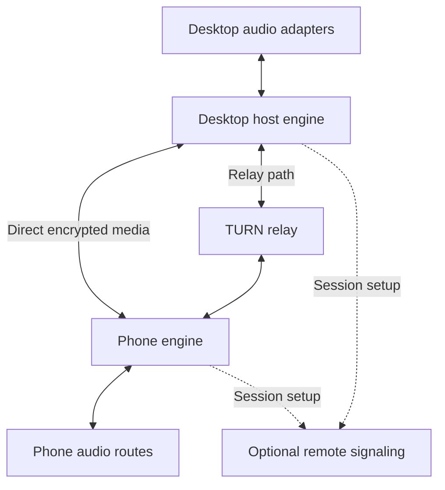

# Architecture

The codebase implements Windows x64, Linux x64, and macOS arm64 desktop hosts
with Android and iPhone playback, microphone return, and duplex over paired LAN
or opt-in remote WebRTC/Opus connections. The Windows Win32 desktop UI and
cross-platform CLI host (`windows-host.exe` on Windows, `micdrop-host` on Linux
and macOS) share the same Go host engine. Kotlin Android UI/foreground services
and Swift/SwiftUI iPhone controllers own phone consent, routing, and session
lifecycle.

The native WebRTC shared library (`micdrop_rtc.dll` on Windows,
`libmicdrop_rtc.so` on Linux, `libmicdrop_rtc.dylib` on macOS) exposes a pure C
ABI loaded by the Go host. Native platform audio adapters — WASAPI loopback on
Windows, PulseAudio/PipeWire (`libpulse.so.0`) `.monitor` streams on Linux, and
macOS 14.2+ CoreAudio Process Taps (`CATapDescription` + `HALOutput` AudioUnit)
on macOS — capture the selected desktop output endpoint and supply stereo PCM to
WebRTC. Android uses the matching WebRTC AAR and media-configured AudioTrack
playback; iPhone uses the matching WebRTC XCFramework with `AVAudioSession`
routing and background lifecycle management. Optional phone microphone capture
sends audio back to an explicitly selected desktop virtual-cable render endpoint.
WebRTC handles Opus, network jitter and clock adaptation. Go and JSON are not on
the PCM audio path.

The desktop return renderer pulls into a bounded reusable 10 ms block; mute
resets its output gate/queue. Playback-only sessions do not enable the phone
microphone. Duplex and supported headset routing are implemented, with device
limits documented in [platform audio](PLATFORM_AUDIO.md) and the [beta guide](BETA_TESTING.md).

## System overview

The direct and TURN paths are alternatives selected by connectivity negotiation, not two parallel copies of the stream. LAN sessions use local signaling and do not depend on the remote service.

### Audio directions

| Direction | Processing order |
| --- | --- |
| Computer playback | Selected desktop render endpoint → loopback capture → format adaptation → Opus/WebRTC sender → network → WebRTC receiver → phone native output → selected physical route |
| Phone microphone | Selected phone input → optional voice processing → Opus/WebRTC sender → network → WebRTC receiver → desktop endpoint bridge → virtual recording endpoint → consuming application |

The network codec does not replace the phone's Bluetooth codec. Bluetooth playback is another OS-managed encoding and playback stage after the network stream is decoded.

## Components and ownership

| Component | Owns | Does not own |
| --- | --- | --- |
| Desktop host | Session state, capture selection, desktop endpoint bridge, configuration, pairing, metrics | Phone route policy or client-app input selection |
| Phone app | User consent, native routing, background lifecycle, input/output, connection controls | Bluetooth firmware or computer driver installation |
| Media adapter | Native WebRTC integration, PCM handoff, effective codec configuration, exported metrics | Product UI or general-purpose file streaming |
| WebRTC engine | RTP/RTCP media, Opus, connectivity negotiation, congestion response, receive jitter handling | Product-specific pairing and authorization |
| Signaling service | Authenticated rendezvous and bounded delivery of session/control messages | Mixing, transcoding, or storing audio |
| TURN service | Forwarding encrypted media when a direct path is unavailable | Audio decoding or user microphone consent |
| Virtual endpoint | Presenting a desktop audio device and bridging samples safely | Network protocols, pairing, or codec processing |

WebRTC deliberately leaves signaling to the application. Its peer-connection and security architecture are background for this design, not a complete product authorization system. [S09, S13](REFERENCES.md)

## Implementation stack

- **Native engine:** C++20 wrapper around a pinned `libwebrtc` source revision. Keep its APIs behind a small project-owned interface because build tooling and native integration change across revisions.
- **Windows:** Go Win32 tray/settings app and console diagnostics share host lifecycle, current-user DPAPI state protection, pairing and configuration. C++ owns audio callbacks, CryptoAPI TURN TLS verification, and WASAPI capture.
- **Linux and macOS:** macOS AppKit menu-bar/desktop app (`MicDrop.app`, macOS 14.2+ arm64) and Unix Go CLI host (`micdrop-host`) share the same desktop controller, pairing, discovery, session, and remote rendezvous stack, with persistent user-data storage (`os.UserConfigDir()/MicDrop`), current-user mode-`0600` AES-256-GCM keystore envelopes, and `flock` state locking. C++ (plus Objective-C for macOS `CATapDescription` and AppKit UI) owns real-time PulseAudio/PipeWire and CoreAudio callbacks and OS-native TURN TLS verification (`SecTrust` + `SecPolicyCreateSSL` on macOS, BoringSSL + system CA bundle on Linux).
- **Android:** Kotlin platform views and lifecycle control with WebRTC's media-configured AudioTrack module for streaming and a matching local AudioTrack output check. The initial AAudio tone/JNI harness is retired. Measure the standard module before considering a custom Oboe/AAudio adapter. The app uses native Android views.
- **iPhone:** Swift/SwiftUI app (`apps/ios`, iOS 17+) over portable `MicDropKit` Swift packages (`MicDropCore`, `MicDropIdentity`, `MicDropTransport` using SwiftNIO/NIOSSL and `swift-certificates`) plus Apple `AVAudioSession`, `SecTrust`, Secure Enclave/Keychain identity, and the pinned WebRTC XCFramework.
- **Remote signaling:** Go rendezvous forwards the paired TLS control connection over WSS. Short-lived TURN credentials support encrypted media relay through coturn. The implemented control protocol uses HTTPS/WSS; gRPC is not part of the current runtime. See [remote signaling](REMOTE_ACCESS.md) and [rendezvous dependencies](../third_party/RENDEZVOUS.md).
- **Build:** native dependencies may require GN/Ninja; use CMake for project code where practical, Gradle for Android, and XcodeGen/`xcodebuild` plus SwiftPM for iPhone. Pinned revisions, build commands, ABI compatibility and provenance are recorded under `third_party`.

This selection trades native build complexity for control over routing, audio callbacks, and measurements. Go still needs a native compiler for cgo; this is not a pure-Go cross-compilation promise. A browser app alone does not satisfy the endpoint and lifecycle requirements.

### Current implementation boundary

`native/media/capi.h` provides the generated test source; its Go binding lives
beside the C++ source so cgo recompiles changes, and CMake builds it for native
tests and Android. `native/rtc/capi.h` separately exposes the WebRTC shared
library (`micdrop_rtc.dll`, `libmicdrop_rtc.so`, `libmicdrop_rtc.dylib`) with
opaque handles and bounded caller-owned text buffers. Native platform callbacks
feed the audio device directly. Go serializes all shared-library operations, including
status and teardown. The [pinned WebRTC dependency](../third_party/WEBRTC.md)
is included in the streaming artifacts with its notices.

`native/platform/windows/capture.h` and `bridge.h` define the isolated desktop
audio C ABI shared across Windows (`capture_windows.cc`), Linux (`capture_linux.cc`),
and macOS (`capture_darwin.cc` and `tap_darwin.m`).
One synchronous native call owns endpoint selection, event-driven or callback-driven capture,
format conversion, and counters. A cancellation event can be signaled from the
Go control side; teardown waits for that caller before freeing the handle.
Capture servicing performs no Go callbacks or file I/O. Optional PCM16 recording
uses fixed, preallocated storage, capped at 64 MiB; after capture stops, Go copies
and writes it. This short-run API is a feasibility harness, not a proposed
streaming queue. The separate `mdw_capture_live` entry point shares capture and
format decoding, then hands borrowed float blocks to the native stereo/resampling
adapter without retaining PCM in Go. B001's
hardware tests still need to characterize idle/resumption and long-session clock
behavior; there is no application catch-up queue.

Keep platform types behind native adapters. Protocol capabilities describe directions, formats, and route behavior rather than platform-specific enums or objects. Android (`AudioTrack` / `AudioRecord` / Media3) and iPhone (`AVAudioSession` / SwiftUI / `MicDropKit`) each implement native phone adapters without requiring Go inside the phone app.

## Desktop process model

“Service” initially means a background host in the signed-in user's session, optionally started at sign-in, with a user-visible control surface. It does not require administrator privileges for routine streaming.

Choose this model for understandable device ownership, pairing, and session lifecycle. It is not based on a claim that Windows services cannot capture loopback audio: Microsoft explicitly documents service/session behavior. A true machine service would need separate access policy, per-user control, endpoint handling, and multi-session tests. [S02](REFERENCES.md)

Define behavior for lock, sign-out, sleep, resume, Remote Desktop endpoint changes, and audio-service restart. The first release supports an already signed-in session; suspend disconnects it, and resume creates fresh buffers and revalidates routes.

## Audio boundary and buffering

Use one receiver jitter controller: WebRTC's NetEq in the proposed design. Keep application PCM handoff queues bounded; do not stack another adaptive jitter buffer on top. NetEq already adjusts playout for network variation. [S10](REFERENCES.md)

Distinguish packet duration, WebRTC processing blocks, device callback size, device buffering, and Bluetooth buffering. They are different quantities. A 10 ms codec setting does not establish 10 ms end-to-end latency.

Audio callbacks perform bounded, preallocated work. Network I/O, logging, allocations, UI events, and blocking synchronization stay outside callbacks. Device-format conversion happens at explicit boundaries; request the native device format and resample where necessary rather than assuming every route runs at 48 kHz. [S04](REFERENCES.md)

For independent clocks, let WebRTC manage network playout adaptation. A platform adapter may need bounded device-clock resampling where the endpoint bridge has its own clock. Assign that correction to one owner per boundary, expose it in metrics, and avoid competing rate controllers. Test long enough to detect drift.

## Microphone bridge

The decoder writes into a selected virtual cable's **render** endpoint; the cable exposes a corresponding **capture** endpoint to other applications. Device labels can be counterintuitive, so the UI must explain both ends. Do not render returned microphone audio to the same speakers being loopback-captured.

A future product driver may expose a recording endpoint fed by a controlled user-mode bridge. The kernel portion must stay minimal. SYSVAD is reference material, not a complete production streaming microphone. See [PLATFORM_AUDIO.md](PLATFORM_AUDIO.md).

## Echo and mixing

Desktop audio is media: bypass voice automatic gain and noise suppression on that path. Phone microphone voice processing is separately selectable and route-aware.

For speakerphone use, select either supported platform echo cancellation or a WebRTC processing path with the correct playback reference and timing. Verify behavior; do not enable two echo cancellers automatically. Acoustic echo cancellation cannot repair a digital routing loop caused by monitoring the virtual microphone back into the captured output. Disable such monitoring by default and document the consuming application's settings.

## Planned repository layout

Current source layout:

| Path | Purpose |
| --- | --- |
| `apps/windows-host` | Desktop UI and console entry points |
| `apps/android` | Android app and isolated pairing platform tests |
| `apps/ios` | Native Swift/SwiftUI iPhone app, simulator tests, and portable `MicDropKit` packages |
| `internal` | Host, identity, protocol, settings and rendezvous adapters |
| `native/media`, `native/platform/windows`, `native/rtc` | Test source, desktop audio adapters (WASAPI, PulseAudio/PipeWire, CoreAudio), and WebRTC C ABI |
| `services/signaling` | Standalone rendezvous service |
| `deploy` | Windows installer and Linux service installation |
| `tools` | Builds, artifact retention, validation and release assembly |
| `docs`, `third_party` | Current guides, historical evidence and dependency provenance |
