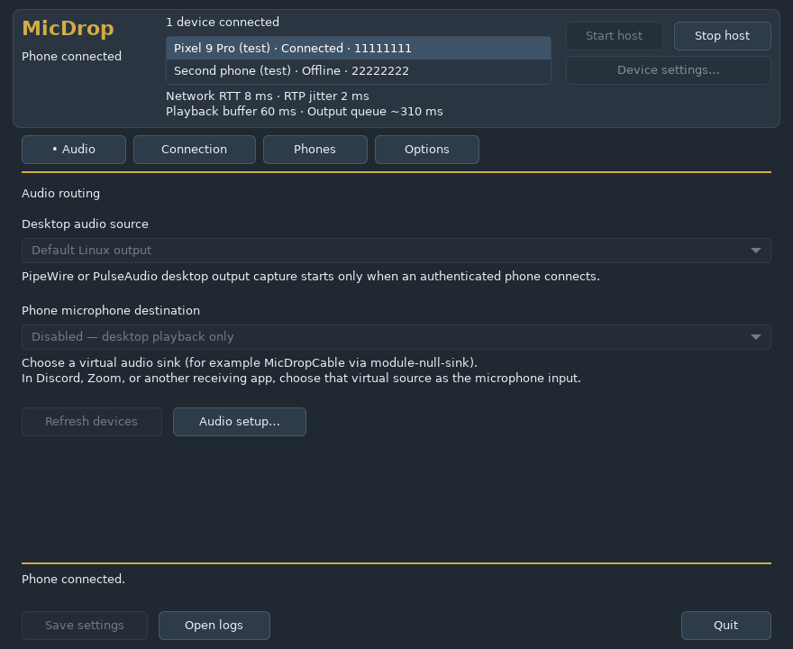
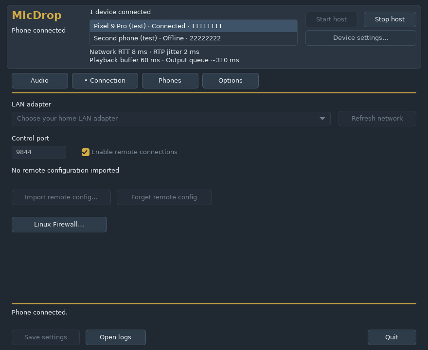
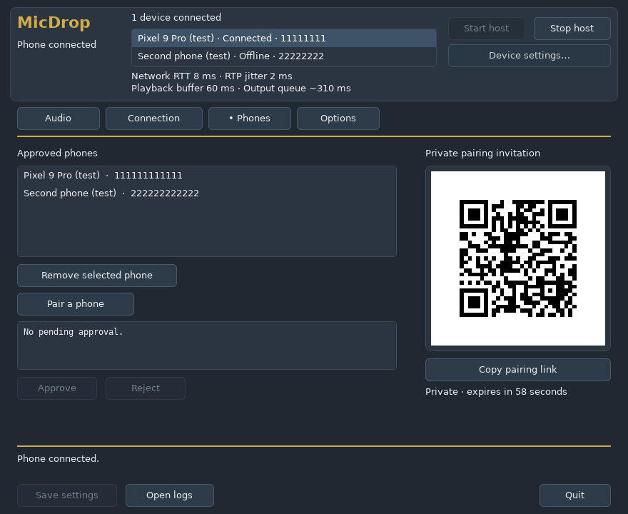
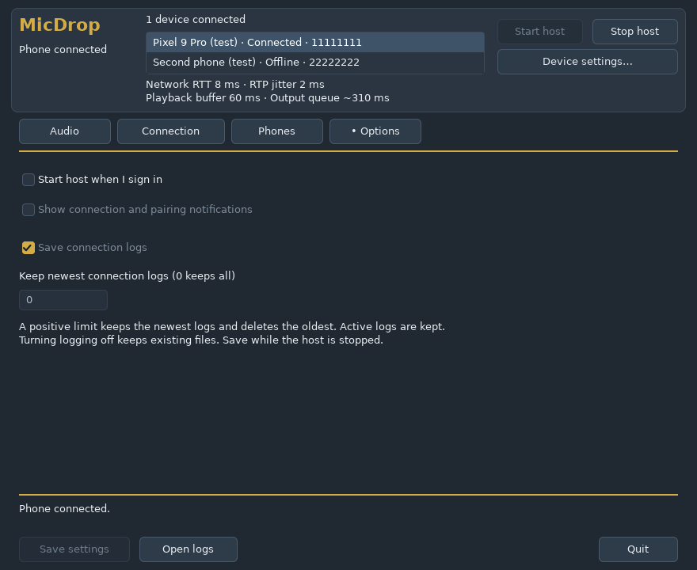
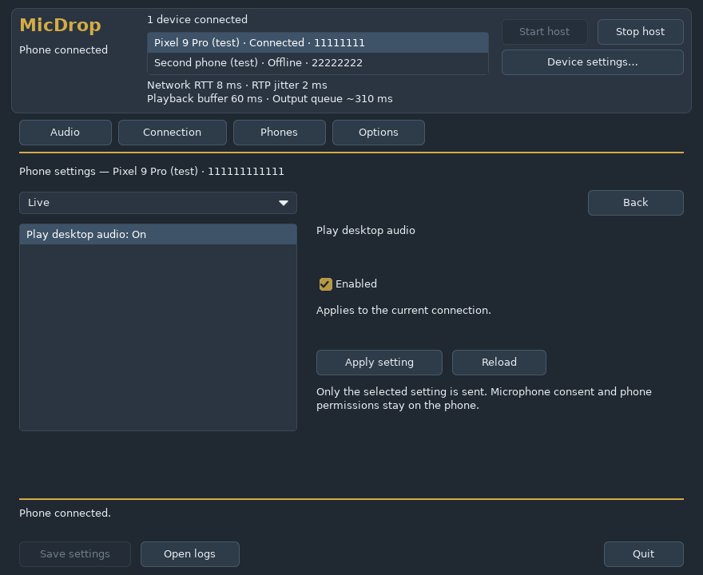

# Linux Desktop App (`micdrop-host desktop`)

`micdrop-host desktop` is the native Linux (`x86_64`, GTK3 on Wayland or X11) desktop host UI. It shares the same Go host controller, settings file schema (`desktop-v1.json`), pairing keystore, LAN discovery, remote rendezvous transport, and phone settings editor as the Windows desktop app (`MicDrop.exe`) and the macOS desktop app (`MicDrop.app`).

## Capabilities and Design

- **Native GTK3 UI (`internal/desktop/gtk_linux_amd64.c`, `ui_linux_amd64.go`, `phone_settings_unix.go`):**
  - Persistent header with host state, Start/Stop controls, connected device summary, live transport metrics (`Network RTT`, `RTP jitter`, `Playback buffer`, `Output queue`), and `Device settings…`.
  - **Audio:** Select `Default Linux output` or a specific PipeWire/PulseAudio sink (captured via its `.monitor` stream) for desktop playback capture, and select `Disabled — desktop playback only` or a user-space virtual sink (such as `MicDropCable`) for phone microphone return, plus an in-app `Virtual mic setup…` guide.
  - **Connection:** Explicit private IPv4 LAN adapter picker, control port (`9844` default), opt-in remote connections toggle, `Import remote config…` (portal-aware `GtkFileChooserNative`), `Forget remote config`, and `Firewall help…` (`ufw` / `firewalld` port guidance).
  - **Phones:** Approved phone list with revocation, private one-time QR code invitation (rendered with nearest-neighbor Cairo scaling), `Copy pairing link`, and request-ID verification (`Approve` / `Reject`).
  - **Options:** Opt-in per-user XDG login startup (`~/.config/autostart/micdrop.desktop` running `micdrop-host desktop --background`), freedesktop D-Bus desktop notifications (`org.freedesktop.Notifications`), and connection log retention controls.
  - **Phone Settings Editor:** Live/Audio/Advanced remote phone settings editing with revision locking and explicit `Reload` protection on concurrent phone-side changes.
- **Zero Hard GUI Dependencies on the Binary:**
  - `micdrop-host` loads GTK3, GDK3, Cairo, GIO, GObject, and GLib at runtime via `dlopen` (`-ldl` only). Headless Linux servers and containers can run every CLI subcommand (`stream`, `doctor`, `rtc-check`, `devices`, `capture`, etc.) without GTK3, Wayland, or X11 libraries installed.
- **Themed System Icons & Optional Tray Indicator:**
  - Uses standard freedesktop themed icons (`audio-input-microphone` and `audio-input-microphone-symbolic`). No custom generated icon artwork is bundled.
  - Automatically detects and loads `libayatana-appindicator3.so.1` or `libappindicator3.so.1` when installed:
    - **With AppIndicator:** Closing the window hides MicDrop to the panel tray (`Open MicDrop`, `Start host`, `Stop host`, `Quit MicDrop`), and `--background` starts hidden in the tray.
    - **Without AppIndicator (stock GNOME without an indicator extension):** Closing the window performs a clean host shutdown and exits rather than leaving an unreachable background process, and `--background` starts minimized in the window list/overview.
  - Respects Linux `HighContrast` / `HighContrastInverse` accessibility themes automatically.
  - Launching a second desktop instance signals the active instance (`desktop.lock` + `SIGUSR1`) to raise and focus the existing window.

## Files and State Locations

- **Desktop preferences, lock & logs:** `$XDG_CONFIG_HOME/MicDrop/desktop-v1.json` (defaults to `~/.config/MicDrop/desktop-v1.json`), `desktop.lock`, and `~/.config/MicDrop/logs/`.
- **Host identity, paired phones & remote config:** `~/.config/MicDrop/identity/` and `~/.config/MicDrop/keystore/` (mode `0700` directories, `0600` AES-256-GCM keystore envelope + `flock`).
- **Optional login autostart:** `~/.config/autostart/micdrop.desktop` (created only when `Start host when I sign in to Linux` is enabled; removed when unchecked).
- **Optional application menu launcher:** `~/.local/share/applications/micdrop.desktop` (installed explicitly via `--install-launcher` and removed via `--uninstall-launcher`).

## Launching and Desktop Menu Integration

Runtime requirements for the desktop UI on Ubuntu/Debian-based distributions:
- `libgtk-3-0t64` (Ubuntu 24.04+) or `libgtk-3-0` (Ubuntu 22.04 / Debian 12)
- `libpulse0` with an active PipeWire (`pipewire-pulse`) or PulseAudio session
- Optional panel tray indicator: `libayatana-appindicator3-1` (plus AppIndicator/KStatusNotifierItem support in your desktop shell)

```sh
# Launch the Linux desktop UI directly from an extracted tarball or local build:
./micdrop-host desktop

# Optional: symlink as MicDrop or micdrop-desktop to default into GUI mode with no subcommand:
ln -s "$PWD/micdrop-host" ~/.local/bin/micdrop-desktop

# Optional: register or remove a per-user XDG application launcher (~/.local/share/applications/micdrop.desktop):
./micdrop-host desktop --install-launcher
./micdrop-host desktop --uninstall-launcher
```

## Virtual Microphone Setup (PipeWire / PulseAudio)

Desktop playback capture works out of the box using any output sink's `.monitor` stream. To route your phone's microphone into desktop apps (Discord, Zoom, browsers, OBS) without feedback loops, create a dedicated user-space null sink and remapped virtual mic source:

```sh
pactl load-module module-null-sink sink_name=MicDropCable rate=48000 channels=2 \
  sink_properties=device.description=MicDrop_Cable
pactl load-module module-remap-source source_name=MicDropVirtualMic \
  master=MicDropCable.monitor source_properties=device.description=MicDrop_Virtual_Mic
```

Then click **Refresh audio** in MicDrop, select **MicDrop\_Cable** under *Virtual cable output for phone mic*, and choose **MicDrop\_Virtual\_Mic** as the microphone input inside your voice/chat app. See [platform audio](PLATFORM_AUDIO.md#linux-host) for persistent PipeWire/PulseAudio configuration.

## UI Preview

Rendered automatically by `xvfb-run go test ./internal/desktop` on `ubuntu-24.04` using synthetic test fixtures:

| Audio | Connection |
| --- | --- |
|  |  |

| Phones & QR Pairing | Options |
| --- | --- |
|  |  |

| Connected Phone Settings Editor |
| --- |
|  |
