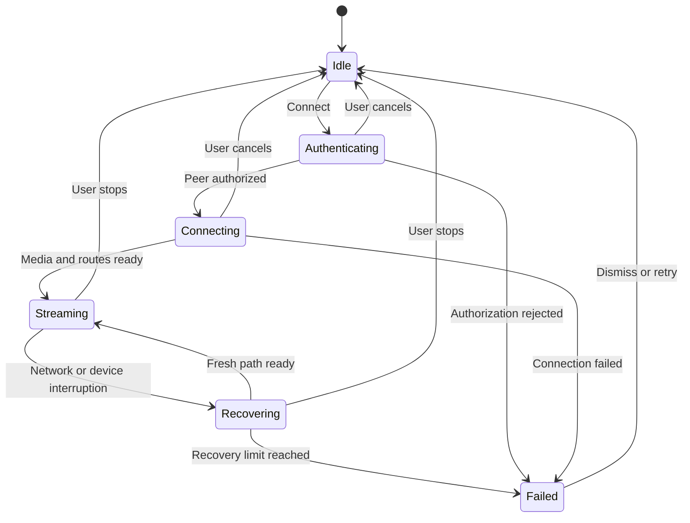

# Connection and media contract

The current app uses the [paired protocol, version 3](PAIRING.md): durable Android
Keystore/Windows identity, approved enrollment, reconnect and revocation. Playback,
microphone-only and duplex sessions share its bounded control/lifecycle rules.
[LAN discovery](LAN_DISCOVERY.md) provides untrusted endpoint hints. Opt-in
[remote access](REMOTE_ACCESS.md) carries the paired control connection over WSS;
media remains WebRTC/DTLS-SRTP. In-session ICE recovery is specified below.

The legacy v2 section documents the optional developer playback probe and the
base control/report structures reused by v3. Its bearer-link limitations do not
replace the paired trust model. The closing design-level message names
are explicitly not a separate implemented API.

Remote invitations use `micdrop://remote/v1/<base64url JSON>` with exactly `url`,
`token`, `connection` and boolean `force_relay`. The inner `connection` is a v1
pairing invitation or the existing local paired record; nested remote wrappers
and legacy bearer-only sessions are rejected. The token authorizes relay resources,
not device pairing. Windows exports only the selected route; Android retains only
the client role. Endpoints keep ordinary outer HTTPS trust and the inner TLS 1.3
phone identity/pinned Windows key and IP SAN checks. No media travels in this tunnel.

Remote-capable Windows hosts also serve the same paired protocol on their explicit
LAN address/port. Signaling selection tries LAN first on
fresh Connect, rendezvous first on automatic recovery, and can move a healthy
rendezvous session to verified LAN. Both listeners share session/cancellation
ownership. Trusted listener context selects public ICE configuration for new
offers; it is not a request header. The inner TLS identity and session protocol do
not change when switching. Lost offers require acknowledged nonce cancellation
before replacement on another transport; ambiguous answers are not replayed.

## Initial remote trickle ICE, version 1

Paired remote callers opt in with `X-MicDrop-Trickle-ICE: 1` on `/offer`.
The response confirms `trickle_ice_version:1` before either side sends an early,
potentially candidate-free description. Later candidates are exchanged in bounded,
ordered, idempotent `ice` batches on the existing POST `/status`. Credentials,
media section and session ownership are checked on receipt.
No candidate details enter diagnostic logs. The initial generation retires at
an ICE restart unless both endpoints negotiate the following extension.

## Continuous remote candidate snapshots, version 1

Updated paired remote callers additionally send `X-MicDrop-Continuous-ICE: 1`.
The Windows resource factory receives this authenticated capability before native
peer creation. Remote peers confirm `continuous_ice_version:1` alongside initial
trickle support. Only then do they use `GATHER_CONTINUALLY` and `continuous_ice`
instead of `ice` on POST `/status`. Older counterparts retain initial trickle.

Each direction sends version, generation, revision and acknowledgment counters.
A changed/unacknowledged revision includes a full current candidate set; unchanged
acknowledged revisions omit it. An explicit empty array removes the previous set.
A new revision may replace a skipped one; conflicting replay and old generations
cannot reach native ICE. Sets are validated entirely before removals/additions,
and bounded to 64 candidates / 32 KiB candidate text.

For continuous sessions only, recovery descriptions are candidate-free and
returned early. The same authenticated recovery answer commits a new exchange
for that generation; status snapshots are rejected while the answer is pending.
The recovery deadlines, throttles and gates below still apply.

## Implemented paired ICE recovery, version 1

A v3 offer response advertises `ice_restart_version:1` only for a native peer
that implements restart. It keeps the negotiated direction, client certificate,
session bearer, audio devices and one combined log. Legacy or older hosts retain
the existing ten-second media recovery and fifteen-second heartbeat limits.
New paired restart-capable sessions use a thirty-second media interruption window
and a thirty-five-second absent-receiver watchdog.

| Request | Authenticated session body | Result |
| --- | --- | --- |
| POST `/recover-offer` | `{"version":3,"generation":1}` | Same generation and a bounded complete ICE-restart offer |
| POST `/recover-answer` | `{"version":3,"generation":1,"sdp":"<answer>"}` | `ok:true` and matching generation; media continues on the existing peer |

Generations start at one and advance consecutively, bounded to 1,000,000. One
pending offer and one accepted-answer digest are retained. An exact offer or
answer retry recovers a lost HTTP reply without another native operation;
conflicting/stale/skipped generations are rejected. Restarts are separated by at
least five seconds; Android attempts at most two in one interruption window.
Recovery neither renews the original media deadline nor creates another session.
An accepted answer renews the control heartbeat. Cached replies do not.

The same approved phone must own every request, alongside the current session
bearer. Offer requests are bounded to 1 KiB, SDP to 64 KiB, answer JSON to 96 KiB;
existing TLS, Origin/query rejection and shared rate/concurrency limits remain.
Stop, revocation, device failure, closed peers and expired sessions reject late
recovery. The native ABI is 8; restarting before the original answer is rejected.

The cable is muted/reset before generating a restart offer. Unmute is unavailable
while its answer is pending. After connected media returns, Android re-verifies
the selected input/output and applies the latest user mute through the ordinary
acknowledged `/microphone` control. No direction or microphone source is added.

Host status adds bounded `ice_restarts` and `ice_recovery_pending` counters/flags.
Android may include `lan_recovery` with a fixed phase, restart count and fixed
signaling transport label only when restart is advertised. Offer responses also
advertise `microphone_processing_version:1`; updated microphone reports may then
include boolean requested echo/noise options. These describe requested policy,
not measured acoustic performance. No addresses, SDP or device identifiers are
added to diagnostic fields.

## Implemented paired duplex extension, version 1

A fresh v3 `/offer` adds both `microphone_return_version:1` and `duplex_version:1`.
Duplex without the microphone capability, unknown/negative/noninteger versions,
legacy v1/v2 or an unpaired/revoked client are rejected before allocation. An
unconfigured host returns 409; there is no downgrade to playback or mic-only.
Missing/zero duplex capability preserves the existing direction selection.

The response confirms `audio_direction:"duplex"`, `microphone_return_version:1`
and `duplex_version:1` before Android creates capture. One sendrecv Opus audio
transceiver carries both directions, using one client-bound secret, peer and log.
Both endpoints retain the existing native media pipeline; HTTP carries no PCM.
The return cable is explicit and starts muted until authenticated `/microphone`
control is applied after a valid answer. That control mutes only the return path.

Duplex Android reports require the fixed `audio_direction:"duplex"` and microphone
schema, and carry incoming playback plus outgoing microphone metrics. Optional
output/recovery fields describe the actual listening path. Mic-only/playback
reports cannot masquerade as duplex; those older schemas remain accepted in their
original modes. A terminal error or Stop ends the complete session. No direction
can be added by heartbeat, media resumption or in-session control; start a fresh
explicit session to change mode.

## Implemented microphone-only extension, version 1

Only the paired v3 listener can accept this direction. Windows must opt in with
`--microphone-device <explicit cable render ID>`. A new authenticated POST `/offer`
adds `microphone_return_version:1` beside `version:3`; missing/zero means ordinary
desktop playback. Unknown feature versions or a microphone request on legacy
v1/v2 are rejected before allocating resources. An unconfigured paired host returns
409 without creating a peer/log. Each accepted mic offer allocates its own fresh
client-bound session secret and isolated receive-only peer; no desktop loopback
capture opens. Direction cannot change inside a session.

The response includes `audio_direction:"phone_microphone"` and
`microphone_return_version:1`; regular responses identify `desktop_playback` and
capability zero. A client checks direction/capability before creating capture.
Windows offers recvonly Opus; Android answers sendonly with a mono 48 kHz built-in
mic and audio playout disabled. The native return renderer starts only after the
authenticated answer, muted. No data/audio travels in HTTP, SDP or Go callbacks.

POST `/microphone` carries exactly `{"version":3,"muted":true|false}` and the
fresh session bearer, plus the same approved TLS client identity. It requires an
answered microphone session and an explicit boolean. Unknown fields, absent/null
state, oversized bodies, other phone/session credentials and stale sessions fail.
The native gate revision stops/resets the cable queue and discards the partial
10 ms block before acknowledging `{"ok":true,"muted":true|false}`. The decoder
continues to pull silence while muted rather than building an application queue.
Controls do not renew the status heartbeat. Bridge failure ends this session;
the listener and durable pairing remain reusable after cleanup.

Android's Send action and microphone permission are independent of pairing and
playback consent. A separate nonexported microphone foreground service owns
capture, wake lock and Mute/Unmute/Stop. Transmission is locally gated while probing
the built-in route and while enabling Windows; input loss/change fails closed.
Mute gates local samples, stops AudioRecord, then requests host mute. Unmute probes
again and releases local samples only after host acknowledgment. Stop/cancellation
always wins over a delayed enable. No microphone mode/consent is stored for media
resumption or a new connection; short recovery belongs only to the current peer.

The existing bounded `/status` report adds an optional `microphone` object with
fixed state/route and actual sample rate/channels; mic sessions require it and
playback sessions reject it. Numeric `sent_bytes_total`, `sent_packets` and
`sent_payload_kbps` are allowed only in mic reports. Host status adds direction,
gate, bridge failure, incoming RTP packets/bytes, rendered frames, buffer capacity
and endpoint mix format. These include silence and do not measure consumer delivery
or physical latency. Other deadlines, report bounds, Stop and revocation rules
are unchanged.

## Legacy diagnostic LAN protocol, version 2

`windows-host stream --host <private IPv4> [--port 9844]` creates an ephemeral
P-256 TLS identity with an IP subject alternative name and 24-hour validity.
The listener requires TLS 1.3. The printed invitation is `micdrop://v2/` followed
by unpadded base64url UTF-8 JSON with exactly these fields:

| Field | Encoding |
| --- | --- |
| `host` | The selected private IPv4 address |
| `port` | Integer HTTPS port, 1–65535 |
| `fingerprint` | 64 lowercase hex characters: SHA-256 of the leaf certificate DER |
| `token` | 32 cryptographically random bytes, unpadded base64url (43 characters) |
| `expires_at` | Integer Unix timestamp in seconds; end of this host run’s authorization lifetime |

Android pins that fingerprint in a **per-session** trust manager, checks certificate
validity, and retains platform hostname verification. The invitation must be
transferred through a trusted/private channel. Possession authorizes sequential
playback sessions during this host run, with only one receiver at a time. Default
lifetime is 12 hours; `--invitation-ttl` accepts 1 minute through 23 hours (shorter
than certificate validity). Expiry ends active playback and the listener. Ctrl+C
or host restart revokes the link; a new run has a new certificate and credential.
The host stores neither on disk. Android still accepts legacy `micdrop://v1/`
links against old hosts using protocol 1, but never saves or reuses them. New hosts
in legacy mode accept only protocol 2: reusable authorization is not inferred from
a v1 link. Paired mode requires protocol 3 and client certificates.

All following requests use HTTPS and `Authorization: Bearer <credential>`.
JSON requests/responses have bounded size and unsupported version/fields fail.

| Request | Credential and body | Success response |
| --- | --- | --- |
| `POST /offer` | Reusable connection token; `{"version":2}` | `version`, fresh `session` token, `sdp`; optional `diagnostics_version:1` advertises combined logging (0 or absent = unavailable) |
| `POST /answer` | Session token; `{"version":2,"sdp":"<answer>"}` | `{"ok":true}`; one answer only |
| `GET /status` | Session token; no body | Sanitized native status JSON; successful request renews the watchdog |
| `POST /status` | Session token; `{"version":2,"android":<typed snapshot>}` (both phone clients use the legacy `android` key) | Same native status plus `report_log` and `report_sequence`; a fresh accepted snapshot renews the watchdog |
| `POST /stop` | Session token; `{}` or `{"reason":"<allowed label>"}` | `{"ok":true}`; host ends the session |

Paired protocol 3 clients may set custom deadlines on the initial `/offer` with
`X-MicDrop-Recovery-Window-Ms` (5000–300000) and
`X-MicDrop-Setup-Window-Ms` (10000–120000). Each optional header must contain
one value of 1–6 ASCII decimal digits. Invalid values, duplicate values, or
these headers on a legacy offer receive HTTP 400 `Invalid connection timeouts`
before capture resources are allocated. Clients send these preferences only
on `/offer`, never on status or recovery/cleanup requests.

Paired protocol 3 clients also send `X-MicDrop-Session-Resume: 1` on `/offer`
when the same phone resumes a paused or interrupted session or replaces its
session for an input change, and may add `X-MicDrop-Session-Resume-Reason`
with one of `manual`, `automatic` or `focus_regain`. Both headers go on every
`/offer` of the resuming attempt, LAN and rendezvous, including 423 retries
and the re-offer after `/cancel-offer`; neither goes on `/recover-offer` or
any other path, on v1/v2 links, or on Connect/Reconnect, including Connect
while Paused and Connect after Stop. The hint is presentation-only: it selects
the Windows desktop status text and suppresses the second **Phone connected**
notice for the same phone, and has no media, pairing, mute, keep-alive or
consent effect. The reason is accepted only together with exactly one
`X-MicDrop-Session-Resume: 1`. The host answers HTTP 400 `Invalid session
resume hint` before reserving a session when the reason header is duplicated,
empty, longer than 32 bytes or uses characters outside `[a-z_]` (uppercase,
comma lists and hyphens are rejected), when a reason arrives without the
resume hint, when the hint itself is duplicated or not `1`, or on a legacy
(v2) offer; an unpaired caller gets 403 first, and the protocol-version,
timeout, phone-control and attempt header checks run before it. A well-formed
unknown token is accepted and treated as unspecified, as is an absent reason
(older phones), so a newer phone never fails a resume against this host.
Older hosts ignore the reason header, and hosts before the hint read neither.
The Windows text for each reason is in
[the desktop guide](WINDOWS_DESKTOP.md#host-ownership-and-settings); the
causes each phone maps to a reason are listed with the pause/resume lifecycle
below.

Current Windows hosts reply to v3 offers with
`connection_timeouts_version:1`, `recovery_window_ms`, `setup_window_ms` and
`heartbeat_timeout_ms`. Recovery is capped at 10000 ms when ICE restart was
not negotiated; the heartbeat timeout is effective recovery plus 5000 ms.
Clients use custom windows only after an exact echo of the expected effective
values. Older hosts that do not advertise version 1 retain legacy limits.
The iPhone sends its typed diagnostic snapshot under the same legacy `android`
member of POST `/status`; that key is a wire contract, not a platform claim.

SDP is at most 65,536 bytes; answer JSON is at most 96 KiB. Offer JSON is bounded
to 1 KiB. Stop JSON remains bounded to 1 KiB unless the offer advertised
`connection_diagnostics_version:1`, which permits an 8 KiB terminal report.
Allowed reasons are `user_stop`, `user_pause`, `focus_loss`,
`focus_loss_transient`, `focus_loss_permanent`, `output_lost`,
`service_stopped`, and `connection_failed`; an omitted reason retains legacy
user-stop behavior. Unknown fields/reasons fail. The host allows four
in-flight handlers and 120 requests per minute total. It rejects plaintext,
browser Origin headers, query strings, unknown endpoints, and unauthenticated
commands. HTTP header/body and native operation timeouts are bounded. No cookies,
redirects, invitation-in-URL requests, audio uploads, or retained recordings are
part of the control flow.

Diagnostics capability version remains 1; it is independent of control protocol
version. Phones use GET when diagnostics were not advertised. When enabled, the next status heartbeat sends the previous Android
snapshot, keeping only one pending sample. Report uploads require an accepted
answer and the current session credential. Requests are at most 16 KiB, unknown
fields are rejected, and positive sequence numbers must increase within this
session. An exact duplicate of the most recent typed snapshot returns its cached
log acknowledgment without logging again or renewing the watchdog. A conflicting
duplicate or older sequence is rejected. Invalid reports do not renew the watchdog.

The Android object contains `sequence`, `captured_at` (RFC3339), `uptime_ms`,
nullable `environment`, fixed `state`/`media_output`/`codec`/`path` labels, and
`metrics` (known finite numeric counters, with null for unavailable). Environment
contains bounded app/build/manufacturer/model/Android strings, API level, expected
route categories, audio mode, screen and battery-saver flags. It has no field for
raw text, filenames, addresses, tokens, SDP, device names or recordings. See
`internal/diagnostics/report.go` and the session contract tests for the schema.

`route_selection_diagnostics_version:1` is advertised only with active logging.
Android then includes optional `route_selection`: version 1, actual local/remote
renomination booleans, their `negotiated` conjunction, ICE `generation` and
`observed_switches` (both bounded to 1,000,000). No candidate ID or credential
is accepted. Native status contains the same observation; the native configured
constructors select remote renomination before creation.

`report_log:accepted` acknowledges the bounded disk queue, not durable storage;
`busy` drops this snapshot while later samples can proceed. `disabled`, `full`,
`unavailable`, or `closed` stops uploads and leaves GET polling/audio working.
Malformed/unsupported upload responses (400/404/405/409/413/422) make Android retry
that poll once as GET, then use the copy fallback. Authentication, expiry and
terminal network errors retain normal failure handling; transient status failures
use the bounded recovery window below. Phone and host timestamps refer
to different clocks, not measured audio delay. The
[Windows desktop guide](WINDOWS_DESKTOP.md#host-ownership-and-settings)
describes file bounds, shutdown and retention.

### Connection and terminal diagnostics extension

An active logger also advertises `output_control_diagnostics_version:1`. Android
media-output sessions may then attach the same bounded `output_control` object to
periodic and terminal reports: version 1; fixed selection/phase/pause labels;
requested enabled state; nullable actual-versus-predicted-default comparison and
Nearby permission; system-route identity-known flag; bounded transfer/playout
recreation counts; fixed transfer request result. No Bluetooth address, name,
port, opaque system-route ID or free-text error is transmitted. The comparison
does not prove audible playback. Absent/0 capability omits the object, preserving
earlier hosts. See `internal/diagnostics/output_control.go`.

An offer advertises `connection_diagnostics_version:1` when combined logging
is active or phone settings exchange was negotiated; absent/0 means an older
Windows build or logging off without phone control, not an unsupported phone,
and the phone's report then says `Windows terminal diagnostics: not requested
by Windows (older Windows or logging off)`. Until Windows returns a 200
`/offer` body that report line reads `not sent; no Windows offer reply`, and
after a reply that failed validation `not sent; Windows offer reply rejected`;
the deadlines and media-recovery lines say `not negotiated` with the same
qualifier. This is separate
from control and periodic diagnostics versions. Old clients may ignore it, and
new Android clients omit all extension fields when an old host did not advertise
it. Native media negotiation and audio/consent policy are unchanged.

Periodic Android snapshots may then add a `connection` object with fixed `peer`,
`ice` and last-observed `host` states plus nullable `runtime`. Runtime contains
screen/battery-saver flags, deep/light idle mode, battery-optimization exemption,
Low Power Standby enabled/exempt state, microphone permission, current foreground
service category, held CPU wake lock, default-network category/validation/metering/
blocking, bounded change count and callback-registration status. Unavailable or
unsupported queries are null/unknown, never interpreted as false. Default-network
observations do not identify WebRTC's ICE route; internet validation is not a
requirement for offline LAN audio. A held wake lock does not prove the OS honors it.

`POST /stop` may include `diagnostics` containing version 1, capture time/phone
uptime, a fixed terminal `code`, connection stage, nullable failure uptime and
HTTP status, current `connection`, and the last 24 fixed-label observations in
monotonic phone receipt order. Earlier observation count is retained. The host
rejects arbitrary labels/text/identifiers, future or unordered event times and
failure/normal-stop inconsistencies. Invalid diagnostics neither stop the session
nor renew its heartbeat. Legacy stop reasons and finalization remain unchanged.
Android retries a diagnostics-specific 400/413/422 rejection once without the
optional extension so schema incompatibility does not prevent graceful Stop.

The reply's `receiver_diagnostics` reports queue-independent acceptance or
logging unavailability. Windows retains one immutable `receiver_end` record with
terminal Android evidence and available Windows status immediately before
`session_end`. The 16 MiB log reserves space for this record and its footer even
after periodic logging reaches its limit; the footer reports
`receiver_diagnostics_written`. Acceptance does not guarantee against disk failure
or process death. Android's final copy report includes the same evidence and
delivery outcome, including when Stop cannot reach Windows. A vanished/crashed
phone or already finalized host may provide no terminal upload; earlier periodic
reports and the host's own end reason remain evidence, not a diagnosed root cause.

The host and phone exchange complete, gathered SDP over the authenticated TLS
session, binding WebRTC's media fingerprints and ICE credentials to the selected
host/invited receiver. No trickle-ICE, public STUN, TURN, or cloud rendezvous is
configured. WebRTC owns ICE consent, DTLS-SRTP, media transport, Opus, and jitter
handling. Only `desktop-output` is sent; Android has a receive-only transceiver
and audio recording disabled. Native production of PCM is gated until the
authenticated answer is accepted.

Pairing has a 45-second limit after the offer request. Accepted sessions expire
after 15 seconds without a successful status request; Android normally polls
every two seconds. Request handling also enforces deadlines, so a late heartbeat
cannot revive a session before the next watchdog tick. The host stops immediately
on capture failure or failed/closed transport. A disconnected transport has up
to 10 seconds to reconnect using its existing ICE session; heartbeats cannot
extend that grace period. The independent 15-second heartbeat limit still applies.
Android also retries transient status I/O and HTTP 429/500/502/503/504 for up to
10 seconds, with bounded requests and no growing report queue. Deadline checks
occur between requests/samples, so observed stopping includes those bounded waits.
TLS/pinning, authentication, negotiation and terminal session errors are never
retried. Lifecycle capability 1 advertised recovery and idempotent diagnostics.
The host now advertises `session_lifecycle_version:2`, adding the three precise
Pause/transient/permanent stop reasons. They finalize logs as `receiver_pause`,
`receiver_focus_lost_transient` and `receiver_focus_lost_permanent`.
Android sends the legacy `user_stop` or `focus_loss` labels when this capability
is below 2. Older hosts still work but may terminate sooner or reject duplicate diagnostics.

Android starts a media foreground service from the visible Connect action. Home,
rotation, task removal and screen lock leave it running; the activity only binds
to its current state. A Media3 library session and media card expose Pause/Play
and Stop. Pause mutes immediately and shows Play while ending the current stream;
Play reconnects live after cleanup, using the same validated saved v2 link.
The media session survives manual pause, with foreground state released after
a short cleanup grace period and no idle wake lock. Stop
mutes locally first, sends authenticated `/stop` before disposing the native peer,
and reports whether Windows acknowledged it. The request uses 2-second connect
and read timeouts on the worker; cleanup never waits for it on the UI thread.
Focus loss, noisy-output loss, or service destruction also ends the transport
session, with a bounded reason in the Windows log. Transient focus loss preserves
an explicit resume intent, focus listener and foreground service for up to five
minutes. A delivered focus gain reconnects after cleanup. Manual Pause, Stop,
permanent loss, output loss and timeout cancel automatic resume. Permanent focus
loss leaves manual Play; Android does not promise a later gain when the other app
stops. Process death may skip cleanup; the host watchdog remains the fallback.
The service is not restarted automatically. Android's media resumption can load
the encrypted saved link on explicit Play; metadata queries never start audio.
Force-stop does not automatically resume.

Android labels each resume for the host as follows. `manual`: Play from
Paused (also from a media item restored after process death), Play while
waiting for audio focus, a Play queued during Pausing, in-app or notification
**Resume duplex** and a queued duplex Resume. `focus_regain`: `AUDIOFOCUS_GAIN`
while waiting for focus, or a focus return during Pausing, in playback and
duplex alike. `automatic`: the microphone or duplex input-switch replacement,
which ends the old session with `user_pause`. The iPhone uses the same three
labels for its Play, end-of-interruption and input-switch resumes. Causes that
cannot be told apart: accessory, car, Assistant and system Play are reported
as `manual` like a person's Play, and a permanent focus loss followed by Play
is `manual`. In-session network or route recovery and the duplex media-output
focus gain are not resumes and send no hint.

After first reaching Playing, Android remembers a successful v2 link, including
endpoint, credential, certificate pin and expiry. A failed connection does not
replace the previous saved link. AES-256-GCM uses a fresh provider-generated nonce
per write and an Android Keystore key; the bounded ciphertext is atomically written
in `noBackupFilesDir`. Backup is disabled. Keystore/file operations are serialized
on one worker. Storage failure does not stop playback or fall back to plaintext.
Forget removes the local key and saved entry; host-side revocation requires host
shutdown/restart. Certificate changes still fail closed.
No phone microphone can be activated by this protocol.

Each accepted, authenticated, well-formed offer reserves a new session and starts
its unique log before native peer initialization. Unauthorized, malformed, expired
or busy attempts and an idle listener create no logs or peers. Initialization
failure finalizes that log. Log failure permits playback with copy-report fallback.
Stop or watchdog failure releases the peer and finalizes the log, then returns the
host to idle. Cleanup runs separately from the Stop acknowledgment. A concurrent
offer receives HTTP 423 until cleanup completes; no native lifetimes overlap.
A fresh 32-byte session secret and fresh report sequence accompany every offer;
old credentials cannot stop, answer, report to, or extend the next stream. Only
`/offer` accepts the reusable credential. Request limits belong to the listener
and do not reset between streams. Offers are never automatically retried: a lost
response may leave an accepted setup occupying the host for up to 45 seconds.
On host shutdown Windows releases native capture before draining active HTTP
handlers for up to two seconds, allowing acknowledgments to flush.

This reusable, bounded bearer link is not persistent device pairing or per-device
revocation. Anyone possessing it can connect while the host is idle and the link
remains valid. Use the v3 paired protocol above for durable identity and per-device
revocation.

## Connection paths

The [rendezvous service contract](REMOTE_ACCESS.md) now defines and implements the bounded
WSS transport for an inner paired TLS connection and `/v1/ice` credential response.
Windows/Android implement the LAN and remote paths below; private-overlay
behavior still depends on that network's routing and firewall policy. Service
resource tokens do not replace paired identities or authorize capture.

| Environment | Discovery and signaling | Media path |
| --- | --- | --- |
| Local network | Local service discovery, QR or manual address; authenticated signaling directly with host | ICE host candidates; direct encrypted media |
| Reachable private overlay/VPN | Manual/remembered address and the same authenticated signaling | Direct path where the overlay permits it; overhead measured |
| Internet | Outbound authenticated WSS connections to a rendezvous service | ICE candidates with STUN assistance; TURN fallback |
| Restricted internet | Same signaling; relay transport according to supported network policy | TURN over UDP preferred; supported TCP/TLS fallback may add delay |

Implemented LAN discovery uses `_micdrop._tcp.local.` with a DNS-SD SRV port, private IPv4 A record, and exactly three TXT fields: `v=1` (discovery schema), `p=3` (paired protocol), `id=<64 lowercase hex SHA-256 SPKI hint>`. The instance is `MicDrop-<first 12 hint characters>`; no secret or device name is advertised. [Discovery version 1](LAN_DISCOVERY.md) defines filtering, limits and lifecycle. Every record is untrusted; only saved pairing keys or a fresh private invitation establish identity. Manual addressing remains available when multicast is blocked. LAN-only mode sends no public STUN requests.

ICE evaluates connectivity; STUN alone cannot guarantee a direct connection through every NAT. TURN supplies a relay path. NAT type, firewall policy, and network change are normal operating conditions. [S11, S12](REFERENCES.md)

Remote operation is opt-in. No automatic router port mapping or requirement to expose the desktop signaling listener publicly. LAN firewall rules must be scoped to intended interfaces/profiles and application ports. Remote mode should use outbound connections where possible. Port ranges and deployment topology are implementation decisions to record in the relevant deployment documentation.

## Session sequence

1. Resolve a candidate host and authenticate its paired identity.
2. Exchange protocol range, capabilities, intended directions, and requested profile.
3. Host authorizes computer-output access and the target input bridge; phone authorizes its local output and any microphone capture.
4. Bind the offer/answer and media certificate fingerprints to authenticated device identities and a fresh session, then exchange ICE candidates.
5. Establish the media connection, confirm actual endpoint routes, and start only the authorized directions.
6. Report effective configuration and diagnostics; apply control changes with acknowledgments.
7. On stop or terminal failure, cease capture/transmission, discard buffers, and release resources.

A paired identity is not an instruction to activate a microphone. A new session begins with the phone microphone disabled, regardless of a remote request.

Use one PeerConnection initially, with two logical audio tracks/transceivers: `desktop-output` is host-to-phone, and `phone-input` is phone-to-host. Direction and authorization remain separate. Do not infer that enabling one requires enabling the other. Host initiates offers; phone requests renegotiation through control to avoid competing offers. Associate candidates with the correct ICE generation and discard stale ones.

## Control messages

These names describe responsibilities; they are not an implemented API.

| Message group | Intended contents |
| --- | --- |
| `hello` / `capabilities` | Supported protocol range, app build, modes, codec settings, device-route capabilities |
| `session.request` / `session.accept` | Fresh session identity, peer identities, requested/authorized directions, effective profile |
| `rtc.offer` / `rtc.answer` / `rtc.candidate` | Library-produced SDP or ICE data, negotiation generation, authenticated session binding |
| `stream.set` / `stream.state` | Requested and effective playback/microphone/mute state; local authorization outcome |
| `route.state` | Actual input/output category, format, transition state, and source-loss reason |
| `profile.set` / `profile.state` | Requested latency/quality policy and what the engine actually applied |
| `health` | Bounded diagnostics; no audio or secret material |
| `session.close` / `error` | Reason code, affected direction, retryability, user action if needed |

Use explicit request IDs, acknowledgments, and monotonic state revisions for idempotent updates. Commands carry protocol version, session ID, and the negotiation generation where relevant. Mute, stop, and disconnect apply locally immediately; remote acknowledgments update status but cannot delay them.

Reject unsupported major versions, unauthenticated state changes, expired sessions, overlarge messages, and replayed negotiation messages. Ignore unknown optional fields only within an otherwise compatible version. Define bounds for SDP, candidate count, message rate, and retained session state in the implemented schema; do not accept arbitrary unbounded payloads.

SDP and ICE are produced and consumed through the WebRTC APIs. Prefer supported codec controls to ad hoc string edits. Any unavoidable SDP manipulation needs narrow parsing and interop fixtures.

## Media profiles

These are starting experiments, not claims about a library's exposed controls or hardware results. Codec rates exclude RTP, encryption, relay, and link overhead.

| Profile | Computer playback | Phone input | Packet duration experiment | Receiver policy |
| --- | --- | --- | --- | --- |
| Low delay / LAN | Opus stereo, initially 128 kb/s | Opus mono, initially 32 kb/s | Prefer 10 ms if supported; compare with 20 ms | Small adaptive delay; preserve stability and report effective buffering |
| Balanced | Opus stereo, initially 128 kb/s | Opus mono, initially 32 kb/s | Begin with 20 ms | Default measured adaptation |
| Resilient / remote | Adaptive bitrate; mono downgrade only with visible status | Opus mono with measured loss recovery | Begin with 20 ms | Permit more buffering within a bounded delay policy |

Opus RTP uses a 48 kHz timestamp clock regardless of the device sample rate. The codec supports multiple frame durations; `ptime` describes packet duration preferences and does not guarantee implementation behavior. Verify packetization and stereo in the actual native build. Do not equate SDP's Opus channel declaration with proof that the source is stereo. [S15](REFERENCES.md)

The media engine must expose requested and effective bitrate, channel count, packet duration, device format, and receiver buffering separately. If a setting cannot be controlled reliably, remove it from the UI and document the limitation.

Use congestion control. Enable loss protection only where supported and measured; in-band recovery can require waiting for subsequent packets, so quality and delay must be considered together. Do not add reliable application-level replay of audio: samples that miss their playout deadline should not build a backlog. Leave any supported deadline-aware recovery to the media engine.

An uncompressed PCM transport is a later controlled experiment, not a second initial protocol. It would need equivalent encryption, clock handling, congestion response, and loss behavior before a fair comparison.

## Session states and failure behavior

Playback and microphone state are tracked independently inside the session. Show reconnecting status without pretending stale data is live. On path replacement, flush affected buffers and renegotiate formats as needed.

A transient ICE recovery may preserve already authorized microphone state only within the same active phone session, with the same confirmed input, permission, and visible ongoing-session indicator. App restart, new session, revoked permission, or source loss resets microphone authorization. Stop after a bounded recovery window; a starting policy is 30 seconds with cancellation available throughout.

Host unavailability, blocked discovery, microphone denial, missing computer input endpoint, unsupported route, incompatible protocol, and relay failure need separate actionable errors. Report when a relay/TCP fallback is active rather than presenting it as an unexplained latency regression.
